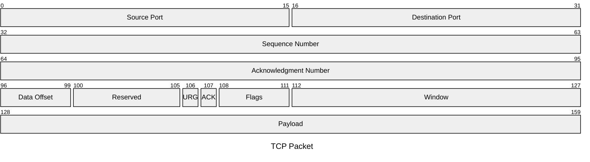

Refs #2813 (umbrella: #2085, map: #2606)

Adds the `packet` / `packet-beta` diagram: parser, SVG renderer, ASCII renderer, both registries, samples (7), docs, API reports, `llms-full`, changeset, snapshots and darwin visual baselines.

## What matches mermaid@12.3.0

The SVG agrees element by element (every rect, label, bit number, viewBox) with the real `mermaid@12.3.0` npm build rendered in headless Chromium: `__tests__/packet-agreement.test.ts` replays 18 recorded renders (`__tests__/fixtures/packet-official-12.3.0.json`): the 7 samples plus edge cases (descending order with split rows, front matter config and title, `bitsPerRow: 1`, custom sizes, 70-bit field, title between fields, escapes, one-line header). Parser rules were taken from the Langium grammar and `packet/{parser,db}.ts` in 12.3.0: `packet` / `packet-beta` (case-sensitive), `a-b`, `a`, `+n`, quoted labels with Langium escapes, contiguity errors, row cutting, the 10000-row cap, config keys `rowHeight bitWidth bitsPerRow paddingX paddingY showBits bitOrder` (`bitOrder: descending` is new in 12.3.0; 12.2.0 has no such key). Colours follow the theme, which is the allowed divergence.

GitHub / mermaid.live: **not checked** (no browser session for either; compared against the real npm build only). Residual differences are listed in `docs/known-differences.md#packet-diagrams` (garbage-in init values, empty title element, theme colours).

## ASCII

Mermaid has no text mode for packets, so there is nothing to match. The drawing is this library's own (boxes with shared borders, bit numbers on the top line, centred label, `…`/`~` truncation, mirrored for descending). `scripts/ascii-topology.ts` is unaffected (new type only; no existing ASCII output changed).

## Visual verification

Real PTY capture (`scripts/ascii-terminal-capture.sh`, agg); there is no "before": the type did not exist (mermaid 12.3.0 has no ASCII output to compare to).

Mockup note: one-bit fields (`URG`, `ACK`) are 2 columns wide in a 32-bit row, so their label is cut to `U…` and their 3-digit bit numbers are dropped; the SVG shows both.

## Tests

- Parser (29), SVG layout/render (7), ASCII (11), agreement (18), init config, detection, MCP/editor/a11y/accessible-name type lists.
- Sabotage-checked: breaking contiguity check, descending column mirroring and descending bit-number swap each fail tests; reverted.
- `pnpm run verify` and `--ci-gates` pass (bundle budgets untouched, headroom ≥4%); diff coverage 99.6%.
- Both SVG and ASCII snapshot/golden/baseline exist for each of the 7 samples (darwin here).

## Open

- **Linux visual baselines** (`-chromium-linux.png`, 14 files) are missing: no Docker here, so `check-visual-baselines` fails until they are added from the CI `visual-regression-failures-*` artifacts (linux-baselines skill). I will add them after the first CI run.

🤖 Generated with [Claude Code](https://claude.com/claude-code)
