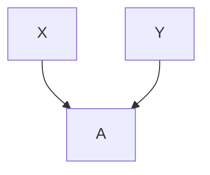
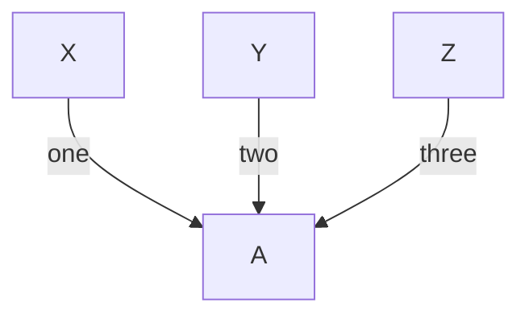
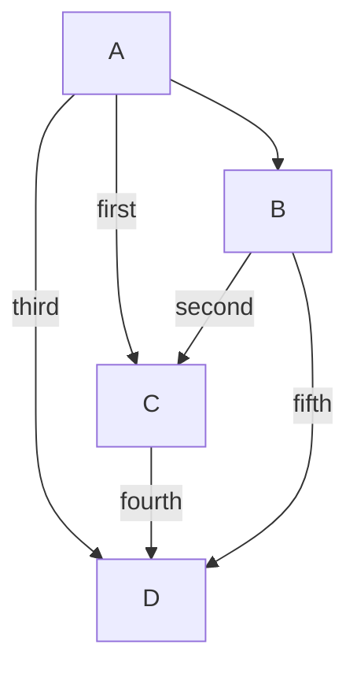
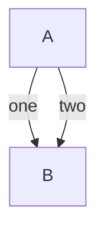
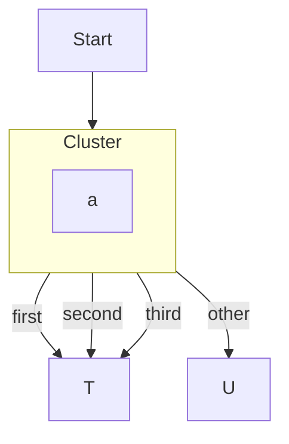
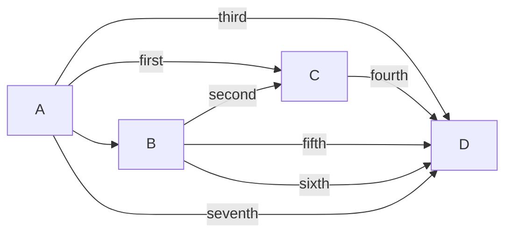

A flowchart is easy to draw in a terminal while every node has one parent and
one child. It gets hard when edges meet: three sources into one box, one box
out to three, two edges between the same pair. The ASCII renderer's job is to
keep those edges distinguishable and keep their labels attached to the right
one. For a while it did that badly in a few specific ways. Four fixes landed
in October; this post covers what each does, shows the current output, and
lists what remains.

Every block below is real output from the renderer at the time of writing
(`renderMermaidASCII`, default options), not a mockup.

## Fan-in: a node with several parents

The renderer used to place a node under its _first_ parent and let the other
parents' edges run in from the side. Mermaid.js centers the child between its
parents. [#1339](https://github.com/dfadler/zombie-mermaid/issues/1339) asked
for that, and its description spells out why an earlier attempt had been
reverted: it moved several upstream-parity goldens, made `backlink_from_bottom`
worse, and lost a label when two labeled edges took the same path.

So it shipped in two steps. [#1346](https://github.com/dfadler/zombie-mermaid/pull/1346)
handles the unlabeled case:



```text
┌───┐   ┌───┐
│   │   │   │
│ X │   │ Y │
│   │   │   │
└─┬─┘   └─┬─┘
  │       │
  │       │
  └───┬───┘
      │
      ▼
    ┌───┐
    │   │
    │ A │
    │   │
    └───┘
```

The two edges bundle into one trunk and `A` sits under its midpoint. The PR
keeps the old first-parent slot in three situations: an incoming edge has a
label, a parent also feeds another node, or the node fans out itself (it is
already placed over its own children). The second rule exists because
`B --> C; B --> D; C --> D` otherwise reads as an edge that never arrives.

[#1344](https://github.com/dfadler/zombie-mermaid/pull/1344) then handles
labeled fan-in. The reason it couldn't just reuse the unlabeled path is the
original bug: if every edge enters through the top, one label gets drawn over
another. Here each parent drops down its own column and enters the child
through its near side, so each label has a stroke of its own:



```text
┌─────┐     ┌─────┐     ┌───────┐
│     │     │     │     │       │
│  X  │     │  Y  │     │   Z   │
│     │     │     │     │       │
└──┬──┘     └──┬──┘     └───┬───┘
   │           │            │
   │           │            │
   │          two           │
  one          │          three
   │           ▼            │
   │        ┌─────┐         │
   │        │     │         │
   └───────►│  A  │◄────────┘
            │     │
            └─────┘
```

That path is limited. Per the PR it applies only in TD/BT, and only when the
child isn't on a cycle; LR keeps the previous right-face routing. The author
found those limits by fuzzing: thousands of random labeled graphs, counting
labels missing from the output. The PR itself notes this only checks that
label text survives, not that the layout looks good, and it lists a case that
still loses a label on `main`: `X -->|one| A; Y -->|two| A; A --> B; A --> C`.

Fan-out has the mirror problem (`A --> B; A --> C` left `A` over `B` only).
[#1340](https://github.com/dfadler/zombie-mermaid/pull/1340) centers a node
over its children in TD graphs. It declines LR, graphs with back edges,
anything inside a subgraph, and children with another parent.

## Fan-in lanes: one arrowhead per edge

Centering decides where the child goes. It says nothing about whether the
edges into it stay separate. In
[#1436](https://github.com/dfadler/zombie-mermaid/issues/1436), `third`,
`fourth` and a plain `B --> D` all ended in a single arrowhead, so a reader
could trace them but couldn't count them.
[#1452](https://github.com/dfadler/zombie-mermaid/pull/1452) closed it, along
with three related issues:



```text
┌────────┐
│        │
│   A    │
│        │
└────┬─┬─┘
     │ │
     │ │
     │ └─────┐
     │       │
     ▼       │
┌────────┐   │
│        │   │
│   B    │   │
│        │   │
└────┬─┬─┘   │
     │ │     │
second │     │
     │ └─────┼──────┐
     │ ┌first┤      │
     ▼ ▼     │      │
┌────────┐   │      │
│        │   │      │
│   C    │   │    fifth
│        │   │      │
└──┬─────┘   │      │
fourth       │      │
   │ ┌──third┘      │
   │ │              │
   │ │ ┌────────────┘
   ▼ ▼ ▼
┌────────┐
│        │
│   D    │
│        │
└────────┘
```

`C` has two arrowheads and `D` has three, one per edge, which is what the PR
description claims for this diagram. Two mechanisms do it: an edge's vertical
run moves to its own free column when it would share two or more cells with
another source's edge into the same node, and edges arriving at one top port
land a stroke apart, ordered left to right by where each comes from so they
don't cross. The group stays merged if it wouldn't fit the node's width or the
rows between layers, so narrow nodes can still end up with a shared arrowhead.

## Parallel edges between the same two nodes

[#1455](https://github.com/dfadler/zombie-mermaid/issues/1455) was a
follow-up: unlabeled parallel edges already drew side by side on the facing
faces, but labeled ones fell back to a side lane.
[#1471](https://github.com/dfadler/zombie-mermaid/pull/1471) removed the
labeled exclusion:



```text
┌─────┐
│     │
│  A  │
│     │
└─┬─┬─┘
  │ │
  │two
 one│
  │ │
  ▼ ▼
┌─────┐
│     │
│  B  │
│     │
└─────┘
```

For vertical groups the labels stagger onto separate rows of the gap. The
fallbacks are unchanged: a reciprocal or other edge on the facing faces, a
blocked channel, a face narrower than `2k+1` for `k` edges, or a group with
more label lines than the gap has rows. A side effect worth knowing about: the
existing lane tests used two labeled edges to exercise lanes, and two now
spread, so those tests were changed to use three.

## Cluster exits: three or four siblings

The same idea shows up at subgraph boundaries.
[#1325](https://github.com/dfadler/zombie-mermaid/pull/1325) lets a group of
three or four sibling edges (same stand-in, same target) engage the shared
cluster exit when other cluster exits are present. Previously only two
engaged; a third needed a gutter track that doesn't exist when the target is
in the first column, and a fourth had none at all. When a sibling only lacks a
track, the planner now inserts one (shifting nodes, grid cells and size
entries). Five or more siblings still take ordinary routing.



```text
  ┌───────┐
  │       │
  │ Start │
  │       │
  └───┬───┘
      │
      │
      │
      │
      ▼
┌───────────┐
│  Cluster  │
│           │
│           │
│ ┌───────┐ │
│ │       │ │
│ │   a   │ │
│ │       │ │
│ └───────┘ │
│           │
└─────┬───┬─┘
      │   └───────────────────┐
      │                       │
      │                       │
      │                       │
      │                       │
      │                       │
      ├────────┬──────┐       │
      │        │      │     other
      │        │      │       │
    first   second  third     │
      ▼        │      │       ▼
  ┌───────┐    │      │   ┌───────┐
  │       │    │      │   │       │
  │   T   │◄───┘      │   │   U   │
  │       │◄──────────┘   │       │
  └───────┘               └───────┘
```

The labels read in source order and each of the three siblings reaches `T`.
The PR also says plainly what it doesn't change: the non-cluster variant
(`a -->|x| T` three times plus `a --> U`) goes through the generic lane
builder and is untouched.

## What is still not fixed: LR labeled fan-in

Issue [#1467](https://github.com/dfadler/zombie-mermaid/issues/1467) is the
hardest case and the one with an incomplete fix. In an LR flowchart, several
labeled edges into one node were routed onto one shared lane and one shared
final drop, so four separate edges looked like one path. Two overlapping PRs
went after it ([#1489](https://github.com/dfadler/zombie-mermaid/pull/1489)
and [#1486](https://github.com/dfadler/zombie-mermaid/pull/1486)), and #1467
closed from #1486's `Closes`, even though #1489's own text called its fix
partial. Here is the repro as it renders now:



```text
┌───┐     ┌───┐         ┌───┐        ┌───┐
│   │     │   │ second  │   │fourth  │   │
│ A ├──┬─►│ B ├────┬───►│ C ├────┬──►│ D │
│   │  │  │   │    │    │   │    │   │   │
└─┬─┘  │  └─┬─┘  first  └───┘  third └───┘
  │    │    │      │             │     ▲
  │    └────┼──────┴─────────────┘     │
  │         │                          │
  └─────────┼────seventh───────────────┤
            │                          │
            ├──────────fifth───────────┤
            │                          │
            └──────────sixth───────────┘
```

What improved: `seventh`, `fifth` and `sixth` each get their own horizontal
lane with the label on it, and `third` no longer stacks beside `D`. What
didn't:

- All the edges into `D` still merge onto one final stem. The labels are
  attributable by lane, but the drops are not separate.
- `first` (A to C) and `third` (A to D) still share the top run out of A, so
  one hop of ambiguity remains.
- The fix is gated. TD flowcharts, unlabeled edges, and the first two labeled
  edges into a node still share a run (a deliberate tee). So "one lane per
  labeled edge" is true only for a labeled edge that shares a bent run with an
  earlier labeled edge into the same target, not in general.
- Nobody has measured the effect on the corpus beyond the 117 samples, or on
  other diagram types.

A record of how that went wrong, since it's useful: #1489 and #1486 each added
a golden for the same repro, and after both merged, `main` went red on the
`lr_fan_in_labeled_lanes_1467` and `lr_labeled_fan_in_split_lanes_1467` cases.
[#1492](https://github.com/dfadler/zombie-mermaid/pull/1492) regenerated the
goldens and [#1494](https://github.com/dfadler/zombie-mermaid/pull/1494)
reconciled the two lane fixes. Two fixes for one repro, merged three minutes
apart, is a coordination bug, not a test bug.

## Takeaways

Fan-in and fan-out are each a layout question (where does the node go) plus a
routing question (do the edges stay separate) plus a label question (does each
label stay attached to its edge). Fixing the first without the others is what
produced the reverted attempt in #1339. The pieces that held up were scoped
narrowly, each with a stated list of cases it declines, and checked against
real output rather than only goldens. The LR case shows the cost of the
opposite: a broad claim of "fixed" that the repro doesn't support.
