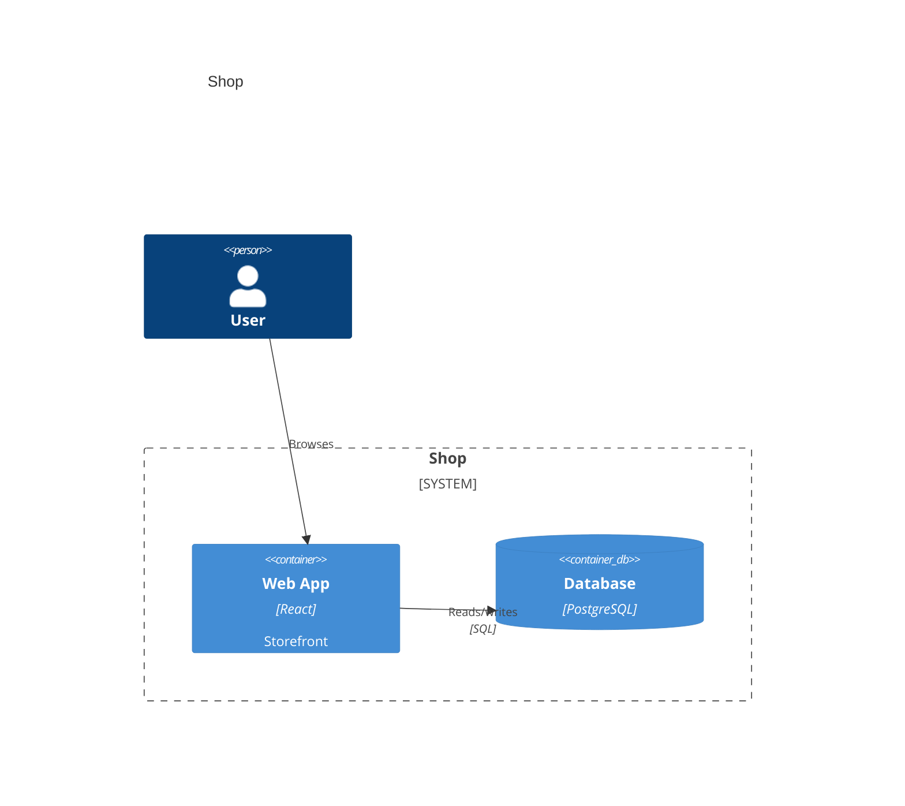
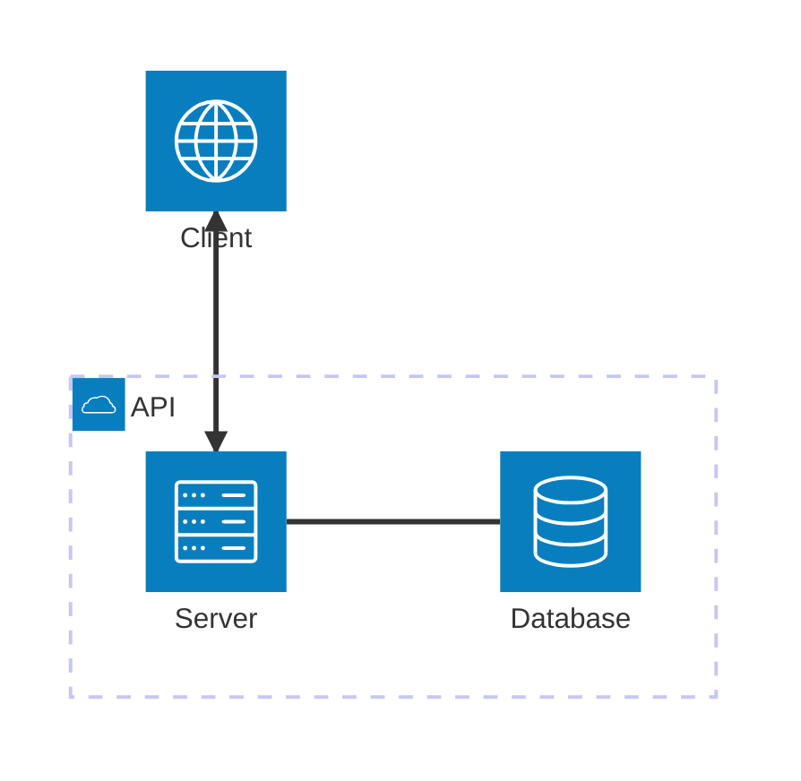
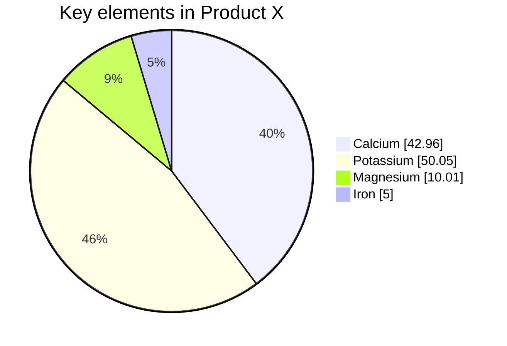

Three diagram types that used to throw `Invalid mermaid header` now render in
both SVG and terminal text: C4
([#1192](https://github.com/dfadler/zombie-mermaid/pull/1192)),
`architecture-beta`
([#1195](https://github.com/dfadler/zombie-mermaid/pull/1195)) and `pie`
([#1371](https://github.com/dfadler/zombie-mermaid/pull/1371),
[#1376](https://github.com/dfadler/zombie-mermaid/pull/1376),
[#1377](https://github.com/dfadler/zombie-mermaid/pull/1377),
[#1381](https://github.com/dfadler/zombie-mermaid/pull/1381)). Every diagram
below was produced by the renderer at build time, and every ASCII block is the
literal output of `renderMermaidASCII(source, { colorMode: 'none' })`.

They are built differently, and that matters for what you have to install and
what you can expect from the layout, so each section says how.

## C4

`C4Context`, `C4Container`, `C4Component`, `C4Dynamic` and `C4Deployment` are
supported. C4 has its own parser and its own SVG and ASCII renderers. It is
not converted to a flowchart first (an earlier attempt that did that was
replaced).



The same source in a terminal:

```text
                Shop

          ╭────────────╮
          │     o      │
          │    /|\     │
          │    / \     │
          │    User    │
          │  [Person]  │
          ╰────────────╯
                 │
                 │ Browses
  ╭╌╌╌╌╌╌╌╌╌╌╌╌╌╌│╌╌╌╌╌╌╌╌╌╌╌╌╌╌╮
  ╎ Shop         │              ╎
  ╎ [SYSTEM]     │              ╎
  ╎              ▼              ╎
  ╎   ┌────────────────────┐    ╎
  ╎   │      Web App       │    ╎
  ╎   │ [Container: React] │    ╎
  ╎   │                    │    ╎
  ╎   │     Storefront     │    ╎
  ╎   └────────────────────┘    ╎
  ╎              │              ╎
  ╎              │ Reads/writes ╎
  ╎              │ [SQL]        ╎
  ╎              ▼              ╎
  ╎ ╭─────────────────────────╮ ╎
  ╎ ├─────────────────────────┤ ╎
  ╎ │        Database         │ ╎
  ╎ │ [Container: PostgreSQL] │ ╎
  ╎ ├─────────────────────────┤ ╎
  ╎ ╰─────────────────────────╯ ╎
  ╎                             ╎
  ╰╌╌╌╌╌╌╌╌╌╌╌╌╌╌╌╌╌╌╌╌╌╌╌╌╌╌╌╌╌╯
```

(Blank padding rows trimmed for the post; the renderer emits a few more.)

### Layout limits

- **The SVG does not use ELK.** It follows Mermaid's own C4 renderer: shapes
  go in rows in declaration order, four to a row, boundaries two to a row.
  Because it needs no layout engine, C4 SVG does not need `elkjs`.
- **`Rel_U`, `Rel_D`, `Rel_L` and `Rel_R` do not move anything in the SVG.**
  This matches Mermaid. Relationships are drawn after placement and never
  influence it, and `RenderOptions.direction` does not move C4 shapes either.
  Swapping `Rel` for `Rel_R` or `Rel_U` in a three-element diagram left every
  shape in the SVG byte-identical when I checked.
- **In ASCII they do matter.** They act as layering constraints. The same two
  containers, once with `Rel(a, b, "uses")` and once with
  `Rel_R(a, b, "uses")`:

`Rel`:

```text
  ┌────────────────┐
  │       A        │
  │ [Container: x] │
  └────────────────┘
           │
           │ uses
           ▼
  ┌────────────────┐
  │       B        │
  │ [Container: x] │
  └────────────────┘
```

`Rel_R`:

```text
  ┌────────────────┐        ┌────────────────┐
  │       A        │  uses  │       B        │
  │ [Container: x] │───────►│ [Container: x] │
  └────────────────┘        └────────────────┘
```

- Other known gaps, from [docs/diagrams.md](https://github.com/dfadler/zombie-mermaid/blob/main/docs/diagrams.md#c4-diagrams):
  `UpdateElementStyle`, `UpdateRelStyle`, `UpdateLayoutConfig`, legends and
  tags are accepted and ignored; ASCII is always top to bottom; and a
  relationship from an element to itself is not drawn in ASCII.

## architecture-beta

`architecture-beta` (and the bare `architecture` header) takes groups,
services, junctions, `in <group>` nesting, and edges with port sides.



```text
┌─────────────────────────────┐
│             API             │
│                             │
│                             │
│ ┌────────┐     ╭──────────╮ │
│ │        │     │──────────│ │
│ │ Server ├─────┤ Database │ │
│ │        │     │          │ │
│ │        │     │──────────│ │
│ └────────┘     ╰──────────╯ │
│      ▲                      │
└──────┼──────────────────────┘
       │
       │
       │
       │         ◯──────────◯
       │         │          │
       └────────►│  Client  │
                 │          │
                 ◯──────────◯
```

### Layout limits

- **It is lowered to the flowchart model, so it uses elkjs.** In a browser or
  bundler you must `npm install elkjs` and call `registerElk(ELK)` once, or
  rendering throws `ElkNotRegisteredError`. Node, Bun, the CLI and MCP load
  `elkjs` automatically when it is installed, and ASCII output never needs
  it. See the
  [`registerElk` reference](https://github.com/dfadler/zombie-mermaid/blob/main/docs/api-reference.md).

  ```ts
  import ELK from 'elkjs/lib/elk.bundled.js'
  import { registerElk, renderMermaidSVG } from 'zombie-mermaid'

  registerElk(ELK) // once, before the first render
  const svg = renderMermaidSVG(source)
  ```

- **It is not placed on Mermaid's port grid.** Ports only pick the flow
  direction and which way each edge points. Look at the output above:
  `db:L -- R:server` still puts `server` to the left of `db`, but exact
  placement is the flowchart layout's call.
- **Icons are not drawn.** `database` and `disk` give a cylinder, `cloud` a
  stadium, `internet` a circle, and any other icon a rectangle.
- `align row` and `align column` are accepted and ignored. ASCII draws a
  junction as an empty box and can misplace nodes when sibling groups are
  joined by cross-group edges.

## Pie charts

`pie` supports `title`, `showData`, quoted `"label" : value` slices,
`accTitle` and `accDescr`. The SVG uses Mermaid's geometry: slices in source
order, clockwise from 12 o'clock, whole-number percentages inside the slices,
and a legend on the right.



Mermaid has no text output for pie charts. This library's is a proportional
bar plus a legend:

```text
             Key elements in Product X

[████████████████████▓▓▓▓▓▓▓▓▓▓▓▓▓▓▓▓▓▓▓▓▓▓▓▒▒▒▒▒░░]

  █ Calcium [42.96]      40%
  ▓ Potassium [50.05]    46%
  ▒ Magnesium [10.01]     9%
  ░ Iron [5]              5%
```

### Limits

- Pie needs no `elkjs`.
- Slices under 1% of the total are left out of the pie but stay in the
  legend, so the drawn labels may not add up to 100%.
- Colours follow the theme (the accent colour first), not Mermaid's
  `pie1` to `pie12`.
- `%%{init: {"pie": ...}}%%` settings (`textPosition`, `donutHole`,
  `legendPosition`, `highlightSlice`) are not supported yet.
- Mermaid's `#quot;`-style character codes in pie labels are shown as
  written.

## What is still not supported

These three are a small part of a wider gap. A coverage check against the
Mermaid 11.17.0 docs
([#1563](https://github.com/dfadler/zombie-mermaid/issues/1563#issuecomment-6100854712),
[PR #1665](https://github.com/dfadler/zombie-mermaid/pull/1665)) found 22
documented diagram types that still throw `Invalid mermaid header` in both SVG
and ASCII, including gantt, mindmap, gitGraph, journey, sankey, block, packet,
radar and treemap. It also found that YAML frontmatter (`title`, `config`) is
rejected for every diagram type, and that `themeVariables` and `themeCSS` had
no effect in the types probed. That check used one probe sample per feature
and counted "accepted" as "no error", not "applied", so read it as a map of
where to look, not a precise score.
