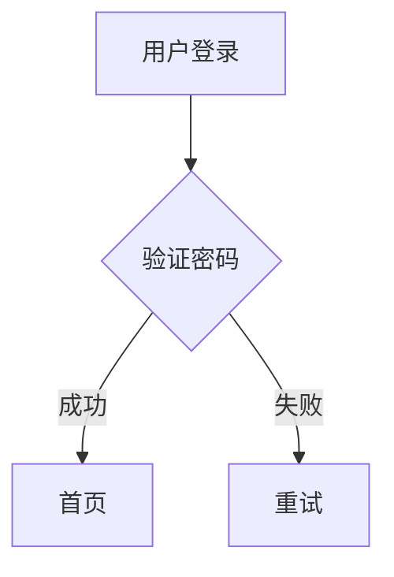

If you render a Mermaid diagram with Chinese, Japanese, Korean or emoji labels to
terminal text, the box borders can end up too short for what is inside them.
That symptom has four issues and a fix PR in
[beautiful-mermaid](https://github.com/lukilabs/beautiful-mermaid)'s tracker, and
every one of them is the same bug seen from a different angle. This post lines them up
against one fix in this fork and says what changed in the thread most recently.

The longer story of how the fork's own width math was fixed, broken and fixed again
is in [Why Terminal Rendering Is Secretly About Unicode](terminal-rendering-secretly-about-unicode.html).
This one is about the upstream side.

## The bug in one paragraph

The ASCII renderer keeps a grid with one cell per column and sized boxes with
`string.length`, a count of UTF-16 code units. A terminal draws a CJK or fullwidth
glyph two columns wide, and most emoji too. A label of `用户登录` has length 4 and
occupies 8 columns, so a box sized for 4 is cut through by its own label.

## The reports

| Upstream                                                         | Opened     | What it says                                   | State when I checked (2026-10-10)                                |
| ---------------------------------------------------------------- | ---------- | ---------------------------------------------- | ---------------------------------------------------------------- |
| [#12](https://github.com/lukilabs/beautiful-mermaid/issues/12)   | 2026-01-30 | Empty body. A commenter called it a duplicate. | Closed                                                           |
| [#13](https://github.com/lukilabs/beautiful-mermaid/issues/13)   | 2026-01-30 | CJK and emoji width in ASCII output.           | Closed 2026-02-23 by a maintainer comment saying v1.0.0 fixed it |
| [#119](https://github.com/lukilabs/beautiful-mermaid/issues/119) | 2026-05-28 | Node labels with CJK misalign boxes.           | Open                                                             |
| [#122](https://github.com/lukilabs/beautiful-mermaid/issues/122) | 2026-06-01 | The grid assumes 1 cell is 1 display column.   | Open                                                             |
| [#128](https://github.com/lukilabs/beautiful-mermaid/pull/128)   | 2026-06-13 | A pull request that fixes #119 and #122.       | Open                                                             |

The odd one is #13. It was closed as fixed in v1.0.0, but #119 and #122 were filed
months later against the same symptom. In #128's thread, a commenter on 2026-07-01
reports that the published 1.1.3 still produced the broken output and that a build of
the PR fixed it. I did not install upstream's releases to check this myself, so treat
"still broken on 1.1.3" as the commenter's report, not my measurement.

## The fix in this fork

The fork's version is [PR #94](https://github.com/dfadler/zombie-mermaid/pull/94),
merged 2026-08-26 and first released in v1.2.0 the next day. Its approach:

1. A shared `displayWidth()` replaces `.length` wherever the ASCII path sizes a box,
   a label, an edge label or a subgraph title.
2. A wide glyph is written into the grid as two cells, the glyph and an empty
   placeholder, so cell count equals terminal columns and every later cell stays in
   its column.

Upstream's #128, as its description reads, makes the same two moves: it measures
display columns, and it stores each wide glyph as a glyph plus a continuation cell
that serialization drops. Two independent-looking proposals landing on the same
representation is a reasonable sign that it is the natural one for a column-major
grid. I make no claim about who had the idea first.

Here is the repro from upstream #119, rendered by the current fork:



Output from `renderMermaidASCII`, plain text:

```text
             ┌──────────┐
             │          │
             │ 用户登录 │
             │          │
             └─────┬────┘
                   │
                   ▼
             ◇──────────◇
             │          │
    ┌────────┤ 验证密码 ├─────────┐
    │        │          │         │
    │        ◇──────────◇         │
  成功                          失败
    ▼                             ▼
┌──────┐                      ┌──────┐
│ 首页 │                      │ 重试 │
└──────┘                      └──────┘
```

(Some blank connector rows are trimmed here for length.) I ran this at HEAD and
checked that every line of the full output measures 38 columns with the fork's own
`displayWidth`. That is a self-consistency check against the same helper that sized
the boxes, so it proves the rows agree with each other, not that your terminal will
draw each glyph at exactly two columns. Terminals mostly agree for CJK. They disagree
more about emoji sequences, which the earlier post covers.

## It took more than one patch

#94 fixed flowchart and state boxes and said so: its description lists class, ER,
sequence and xychart diagrams as having their own width logic and out of scope. The
rest followed as separate fixes:

- Multi-compartment boxes (class and ER): [#203](https://github.com/dfadler/zombie-mermaid/pull/203), merged 2026-08-27.
- Combining marks and composed emoji, by switching to grapheme clusters via `Intl.Segmenter`: [#232](https://github.com/dfadler/zombie-mermaid/pull/232), merged 2026-08-28.
- Sequence diagrams: [#379](https://github.com/dfadler/zombie-mermaid/pull/379), merged 2026-09-02.

Upstream's #128 describes covering flowchart, sequence, class, ER and xychart in a
single pull request, and it uses grapheme clusters from the start. That is a real
difference in scope. In this fork, `packages/ascii-renderer/src/xychart.ts` does not
import the display-width helpers, and I have not rendered a CJK xychart to see
whether that matters.

## What is new since the last post

The last post before this one is dated 2026-09-24. The width fix itself is older than
that: the code in #94, #203, #232 and #379 all merged before it. What happened since:

- The ASCII pie chart renderer ([#1377](https://github.com/dfadler/zombie-mermaid/pull/1377),
  merged 2026-10-06) measures its title and row labels
  with the same `displayWidth`, so it inherits the behaviour.
- Upstream's #128 thread picked up two comments. On 2026-10-05 a commenter reported
  vendoring the PR into a downstream project, txssu/claude-mermaid#1, while waiting for
  a merge. On 2026-10-06 I replied on #128 that the fork has the fix, with the
  release it first shipped in.

Nothing in the width math itself changed since 09-24, and the 7px ASCII cell in
[#1199](https://github.com/dfadler/zombie-mermaid/pull/1199) is browser-mockup CSS and
tests only. It affects how crisp vertical strokes look in the site's HTML preview,
not what the renderer emits.

## What I would do next

The fork replied on each of these upstream issues (#12, #13, #119, #122 on 2026-08-29,
#128 on 2026-10-06) with a pointer to the fix. At the time of writing, the author of
#128 has not replied on that thread. If they do, the useful outcome is not a fork
announcement but a comparison: run their test inputs against this fork's output and
see where the two disagree.

If you hit a CJK or emoji label that still misaligns, [open an issue](https://github.com/dfadler/zombie-mermaid/issues)
with the Mermaid source. Every width bug in this family so far was a code path that
had its own length math and had never been given a wide-character test.
