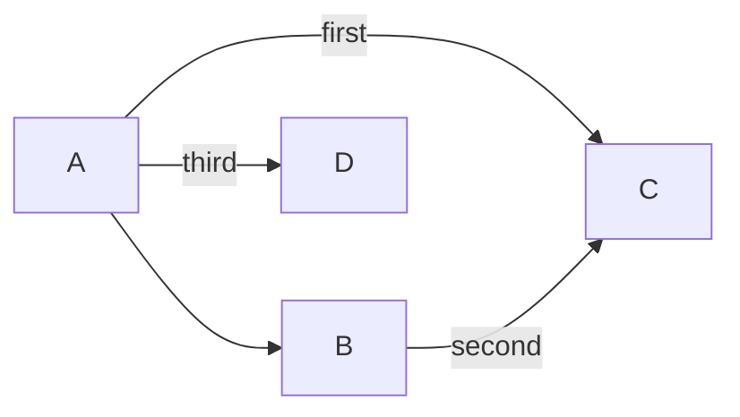

Issue [#1239](https://github.com/dfadler/zombie-mermaid/issues/1239) said two
flowchart samples looked worse than official mermaid.js 11.17.2: in the CI/CD
pipeline sample the subgraph sat below the nodes it should be beside, and an
edge ran across the subgraph's title. "Looks worse than the reference" was a
judgment made from two screenshots side by side. It was hard to tell whether a
fix helped, so the first useful thing to ship was a ruler.

## The layout oracle

[#1314](https://github.com/dfadler/zombie-mermaid/pull/1314) added
`pnpm run layout:oracle`. It renders every flowchart sample in
`samples/samples-data.ts` twice, once through real mermaid.js in headless
Chromium and once through our layout engine, then reads node and subgraph
positions back from both.

Absolute coordinates never match (different fonts, padding, node sizes), so it
compares arrangement only. For every pair of nodes, do both layouts put one
above, below or level with the other, and left, right or level? Two centres
within 20px count as level. A third figure checks whether both layouts agree a
node is inside a subgraph's box. The columns in the output are vertical
agreement, horizontal agreement, containment, and node count.

It is a diagnostic, not a CI gate. It needs a Chromium install and a real
browser render, and it only handles flowcharts, because the node ids it reads
back from mermaid's SVG are flowchart-specific.

## Why subgraphs were wrong

[#1315](https://github.com/dfadler/zombie-mermaid/pull/1315) describes the
cause. Our layout engine, ELK, lays a subgraph's contents out as a block before
the nodes around it, so an outside node can never sit beside something deep
inside the subgraph, and an edge from outside can't pull a member into a later
layer. mermaid.js (dagre) lays the whole graph out flat, ranks every node on
its own, and draws each subgraph as a box around its members.

The fix was spread over several PRs under #1239. Two matter most:

- [#1313](https://github.com/dfadler/zombie-mermaid/pull/1313) breaks cycles
  the way dagre does, with a depth-first walk that reverses the edge pointing
  back at a node still on the stack, before ELK sees the graph. Which edge of
  a cycle gets reversed decides the whole layout, and this is what stopped the
  Git Branching sample from being drawn backwards.
- #1315 lays subgraph diagrams out flat, the way mermaid.js does.

A side finding from
[#1334](https://github.com/dfadler/zombie-mermaid/pull/1334): the obvious
alternative, ELK's `MODEL_ORDER` cycle breaking on every flowchart, was
measured and rejected. It would have moved five gallery samples and made four
of them score worse, so current behavior stayed.

## What the oracle said

The scores quoted in #1315 for the CI/CD sample, vertical / horizontal:

| Sample              | before #1315 | after     |
| ------------------- | ------------ | --------- |
| CI/CD Pipeline      | 48% / 52%    | 95% / 76% |
| System Architecture | 82% / 93%    | 96% / 93% |

Here is the oracle run on the current branch point (27 flowchart samples, the
rows that are not 100% on every figure):

```text
 vert horiz   in   sg  nodes  sample
 95%  76% 100%  sg    7  CI/CD Pipeline
 96%  93% 100%  sg   10  System Architecture
 90%  95%   -         7  Decision Tree
 95%  86%   -         7  Git Branching Workflow
 17% 100%   -         4  Labeled Fan-In (LR)
```

The other 22 flowchart samples, including the three plain subgraph ones
(Subgraphs, Nested Subgraphs, Subgraph Direction Override), score 100% on
everything.

State diagrams had a similar inverted-layout problem
([#1240](https://github.com/dfadler/zombie-mermaid/issues/1240), fixed in
[#1280](https://github.com/dfadler/zombie-mermaid/pull/1280) and, for composite
states, [#1287](https://github.com/dfadler/zombie-mermaid/issues/1287) via
[#1295](https://github.com/dfadler/zombie-mermaid/pull/1295)). Those were
checked against screenshots and node positions, not scored by the oracle,
which only reads flowcharts.

## What it does not say, and a miss

This is where an honest account has to include the bad row. A
[fidelity audit of the snapshots](https://github.com/dfadler/zombie-mermaid/issues/1592#issuecomment-6100809326)
ran the oracle and flagged Labeled Fan-In (LR) as a bug candidate: horizontal
agreement is 100% but vertical agreement is 17%. Every other flowchart is at
90% or better. The sample is four nodes with labeled edges into one target:



Our layering and ordering disagree with mermaid.js about which of these nodes
sit above or below which. The audit marked it an unconfirmed bug: it had the
number but not yet a side-by-side look, and the committed baseline would encode
whatever order we produce. The same audit pass listed CI/CD, Git Branching,
System Architecture and Decision Tree as having subgraphs or fan-out and
scoring lower, with the cause "bug or intentional, undocumented".

Two limits to keep in mind when reading any of these numbers:

- Only relative placement is compared, so a layout can score 100% and still
  route an edge badly. Edge routing is covered separately, for example by
  [#1430](https://github.com/dfadler/zombie-mermaid/pull/1430), which pins
  that no CI/CD edge crosses the subgraph title and that edges touching
  `develop` in the branching sample no longer share one trunk.
- 27 samples are scored. The gallery has more than 100 samples, and the other
  diagram types have no layout score at all. The audit put layout coverage at
  roughly 23% of the gallery.

An open pull request,
[#1661](https://github.com/dfadler/zombie-mermaid/pull/1661), adds a history
and scorecard on top of the oracle so these numbers can be tracked over time
rather than rerun by hand. It is not merged as of this writing, so the table
above is the raw script output.

**Update, 2026-10-12.** All figures in this post were measured against mermaid
11.17.2 with 27 flowchart samples. The reference has since moved to 12.1.0,
which lays flowcharts out with ELK instead of dagre, and the oracle now scores
flowchart, state, class and ER samples. The scorecard at
`docs/layout-fidelity-scorecard.md` has the current numbers (flowchart: 37
samples, vertical 98%, horizontal 95%); the sample that scored 17 percent here
now scores 100 percent on 12.1.0.

## Takeaway

The oracle did two jobs. It showed that the subgraph work moved CI/CD from
48% / 52% to 95% / 76%, and it found a sample at 17% that nobody had flagged by
eye. Run it with `pnpm run layout:oracle`; add `--filter=<text>` for one
sample.
