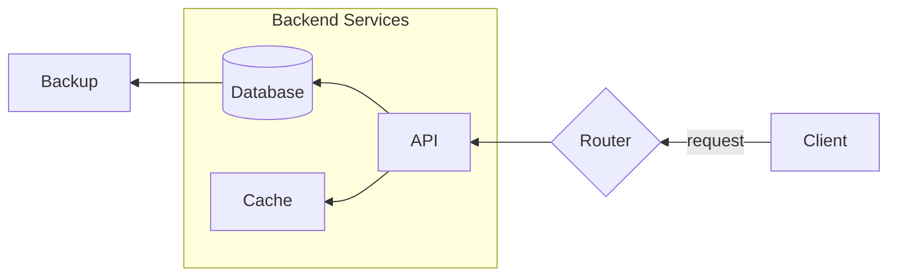
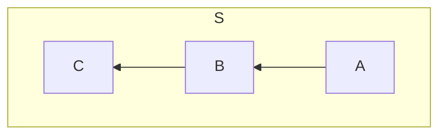
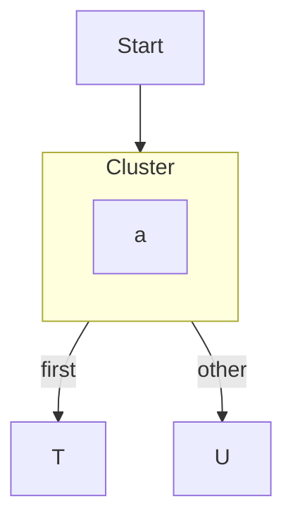
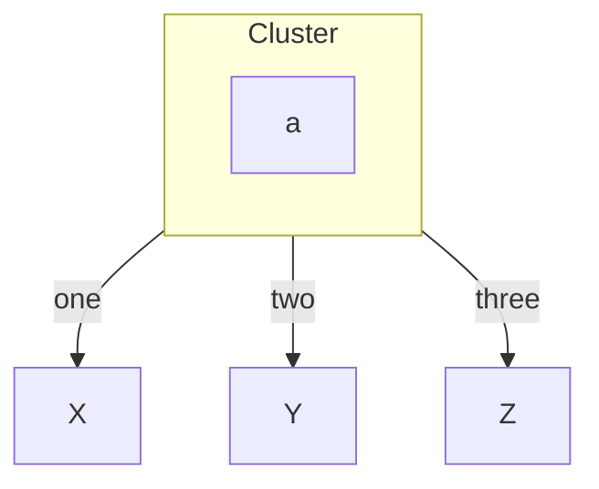

Two things in the ASCII renderer were quietly wrong for a long time. `graph RL`
was drawn identically to `graph LR`, so the arrows pointed the wrong way for
anyone who asked for right-to-left. And an edge leaving a subgraph (or a
composite state) started wherever the router happened to find a free cell,
often straight through the cluster's border. Over the first ten days of
October both got real fixes. Every block below is output from the current
renderer, not a mock-up.

## RL is a real mirror now

The fix in [#1259](https://github.com/dfadler/zombie-mermaid/pull/1259)
(closing [#1231](https://github.com/dfadler/zombie-mermaid/issues/1231))
follows the same pattern BT already used for the vertical axis: lay the
diagram out as LR, then mirror the finished canvas horizontally. Arrowheads,
corners, tees and diagonals are swapped for their mirror glyphs. Labels are
the careful part. Node labels, edge labels and subgraph titles are
pre-reflected before the flip, so they still read left to right and are never
glyph-remapped. A label containing `<` or `/` stays intact. Wide-character
cells travel with their glyph.



```
             ┌──────────────────────────┐
             │     Backend Services     │
             │                          │
             │                          │
┌────────┐   │ ╭──────────╮     ┌─────┐ │   ◇────────◇         ┌────────┐
│        │   │ │──────────│     │     │ │   │        │         │        │
│ Backup │◄──┼─┤ Database │◄────┤ API │◄┼───┤ Router │◄request─┤ Client │
│        │   │ │          │     │     │ │   │        │         │        │
│        │   │ │──────────│     │     │ │   │        │         │        │
└────────┘   │ ╰──────────╯     └──┬──┘ │   ◇────────◇         └────────┘
             │                     │    │
             │                     │    │
             │                     │    │
             │                     │    │
             │                     │    │
             │ ┌──────────┐        │    │
             │ │          │        │    │
             │ │  Cache   │◄───────┘    │
             │ │          │             │
             │ └──────────┘             │
             │                          │
             └──────────────────────────┘
```

Client is on the right, the flow runs leftward, and "Backend Services" still
reads normally. Because the layout is literally the unchanged LR layout, the
subgraph frame and the way edges leave the cluster come out right without any
RL-specific routing.

The PR notes one known limitation: asymmetric node-shape glyphs, such as the
slant of a parallelogram, are mirrored along with the canvas, exactly as they
already are under BT. The tests are an exact-mirror comparison against LR in
both Unicode and ASCII arrowhead modes, plus label-integrity cases, and the PR
reports sabotage-checking them by disabling the label pre-reflection and the
arrowhead remap and confirming tests fail.

### Direction inside a subgraph

[#1449](https://github.com/dfadler/zombie-mermaid/pull/1449) (closing
[#1421](https://github.com/dfadler/zombie-mermaid/issues/1421)) did the same
for a `direction RL` or `direction BT` declared inside a subgraph. Before, it
was drawn as LR or TD. Now the subgraph's own box is mirrored in place after
the normal layout:



```
┌───────────────────────────┐
│             S             │
│                           │
│                           │
│ ┌───┐     ┌───┐     ┌───┐ │
│ │   │     │   │     │   │ │
│ │ C │◄────┤ B │◄────┤ A │ │
│ │   │     │   │     │   │ │
│ └───┘     └───┘     └───┘ │
│                           │
└───────────────────────────┘
```

C, B, A from left to right, which is what Mermaid does. The flip is relative
to the direction already drawn around it, so `RL` inside `graph RL` flips
nothing. A subgraph that has an edge crossing its boundary is left alone and
inherits the parent's direction. The PR lists one known gap: under a nested
`BT`, the subgraph title moves to the bottom border, the same as the existing
root-level `BT` behavior with subgraphs.

## Edges that leave a cluster

The other half of the story is the case from
[#1135](https://github.com/dfadler/zombie-mermaid/issues/1135): a composite
state or subgraph with two or more edges to targets beyond it. Edges used to
start from whichever cell the pathfinder picked, which could cut through the
cluster wall.
[#1148](https://github.com/dfadler/zombie-mermaid/issues/1148) was chosen
after three candidate designs were written up and compared, and shipped as
v1 in [#1187](https://github.com/dfadler/zombie-mermaid/pull/1187): when two
or more edges leave a cluster toward targets past its flow-side wall, they now
leave from the cluster's wall and fan out in the gutter outside it. Clusters
with a single exit, parallel-lane siblings and graphs with no
subgraph-addressed edges keep the old path.

v1 deliberately left things out, and those are what
[#1182](https://github.com/dfadler/zombie-mermaid/issues/1182) tracked. Two
follow-ups closed it:

- [#1224](https://github.com/dfadler/zombie-mermaid/pull/1224): a group of
  parallel edges to the same target (`S -->|first| T` plus `S -->|second| T`)
  now joins the cluster's exit plan whole and counts as one exit. Before, one
  of those plus another exit failed to engage and that other exit punched
  through the wall.
- [#1352](https://github.com/dfadler/zombie-mermaid/pull/1352): each exit
  gets its own tee on the wall instead of all sharing one cell, nearest the
  center of its target and in target order so strokes do not cross.



```
            ┌───────┐
            │       │
            │ Start │
            │       │
            └───┬───┘
                │
                │
                │
                │
                ▼
          ┌───────────┐
          │  Cluster  │
          │           │
          │           │
          │ ┌───────┐ │
          │ │       │ │
          │ │   a   │ │
          │ │       │ │
          │ └───────┘ │
          │           │
          └─┬───────┬─┘
  ┌──first──┘       │
  │                 │
  │                 │
  │                 └──other──┐
  ▼                           ▼
┌───┐                       ┌───┐
│   │                       │   │
│ T │                       │ U │
│   │                       │   │
└───┘                       └───┘
```

Two exits, two tees on the wall (`┬` twice on the bottom border), labels on
each edge's own final leg.

### Whose label is that?

With three or more siblings, the shared gutter made it hard to tell which
drop belonged to which label
([#1331](https://github.com/dfadler/zombie-mermaid/issues/1331)).
[#1461](https://github.com/dfadler/zombie-mermaid/pull/1461) gives each exit
its own track, farthest target first so a nearer exit's drop never crosses a
farther exit's run:



```
        ┌─────────┐
        │ Cluster │
        │         │
        │         │
        │ ┌─────┐ │
        │ │     │ │
        │ │  a  │ │
        │ │     │ │
        │ └─────┘ │
        │         │
        └─┬──┬──┬─┘
  ┌──one──┘  │  │
  │          │  │
  │          │  │
  │          │  └──three──┐
  │          │            │
  │          │            │
  │          │            │
  │          │            │
  │          │            │
  │          │            │
  │          │            │
  │         two           │
  ▼          ▼            ▼
┌───┐     ┌─────┐       ┌───┐
│   │     │     │       │   │
│ X │     │  Y  │       │ Z │
│   │     │     │       │   │
└───┘     └─────┘       └───┘
```

Each label sits on its own vertical run, so there is no ambiguity about who
owns what. That PR is upfront about the price: it also changes the two-exit
layout, which now takes one more row (or column in LR), and an exit aimed
straight ahead can end up with a longer final leg than before.

That price is the open question behind
[#1462](https://github.com/dfadler/zombie-mermaid/issues/1462): the Mermaid
SVG centers the cluster over its targets with the edges fanning out
symmetrically, while the ASCII cluster sits off to one side and the result is
taller. The issue was filed as a to-investigate item, not a settled design, so
treat the output above as the current state, not the final shape.

## What is still rough

- The parallel-lane example from #1224 produces a legal but busy diagram, with
  the `second` label sitting mid-run. Check yours before assuming it reads
  well.
- Entry-side anchoring, where edges arrive at a cluster, was split off as a
  follow-up and is not part of any of the above.

Found a diagram that looks wrong? File an issue with the Mermaid source and we
will render it against the current build.
