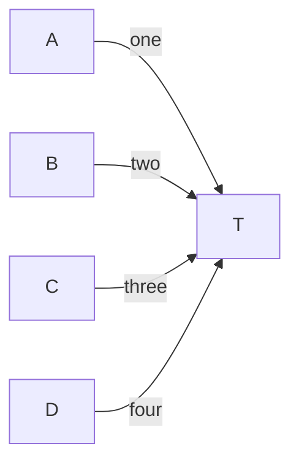
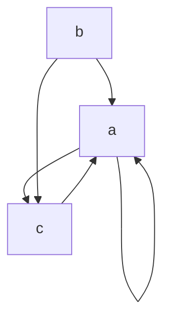

# Known differences from mermaid.js

Places where zombie-mermaid renders or parses differently from mermaid.js and the
difference is either intentional or not yet fixed. The reference is the pinned
`mermaid` devDependency (12.2.0), rendered headless through
`scripts/lib/real-mermaid.ts`; GitHub renders 12.1.0 and mermaid.live 12.2.0 (see the
table below). The pin matches mermaid.live, not GitHub.
The pin moved from 11.17.2 in the bump that added this note, and entries not
listed below as re-checked were measured on 11.17.2: other versions may differ.
The "Labeled Fan-In (LR)" mirrored-order entry that used to sit under layout
tie-breaks was removed after a re-check: on 12.1.0 mermaid and zombie-mermaid agree
(100% / 100%, it was 17% on 11.17.2).

## Which mermaid each surface renders (checked 2026-10-22, #2184)

| Surface                        | mermaid | Default layout | Evidence                                                                                                                   |
| ------------------------------ | ------- | -------------- | -------------------------------------------------------------------------------------------------------------------------- |
| Pinned oracle (`package.json`) | 12.2.0  | ELK            | `mermaid.mermaidAPI.getConfig().layout` is `elk` headless                                                                  |
| GitHub ` ```mermaid ` blocks   | 12.1.0  | ELK (config)   | Renderer bundle `viewscreen.githubusercontent.com/static/assets/mermaidMarkdown-*.js` matches 12.1.0, not 12.0.0 or 12.2.0 |
| mermaid.live                   | 12.2.0  | ELK            | The editor shows `v12.2.0`; node positions equal the headless ELK render                                                   |

GitHub's bundle reports `version:"0.0.0"` and its renderer sits in a cross-origin
iframe, so its version is inferred, not read: it contains identifiers added in 12.1.0
(`orientFeedbackEdges`, `applyOverride`) and none of the 12.2.0 additions
(`upperCaseDirection`, `isUnconnected`, `colorBy`). 12.1.0 and 12.2.0 place the dense
samples identically (gallery "Dense Duplicate Edges" TD and LR, and the #2160 sample 3
with and without `n0["n0"]`/`n1["n1"]` declarations), so either version is a valid target on
both surfaces; `layout: dagre` places them differently. Re-run the check when the pin
moves; `tsx scripts/lib/mermaid-pin-freshness.ts` prints the last versions seen.

## Subgraph inner direction

Re-checked on 12.1.0 (and 11.17.2). Given `subgraph S` holding `a --> b --> c` in a
`graph TD`:

- **No `direction`.** mermaid 11.17.2 flipped an uncrossed subgraph perpendicular to
  its parent (row inside a `TD` graph). mermaid 12.1.0, mermaid.live and GitHub do
  not: the subgraph follows its parent (column). zombie-mermaid never flips, so it
  matches 12.x. A 11.x-based comparison shows a difference that is not one.
- **Explicit `direction`.** Both versions keep it unless an edge crosses the subgraph
  boundary, or an ancestor's. An edge to or from the subgraph's own id (`X --> S`,
  `S --> Y`) does not cross it, so `direction LR` plus `X --> S` is a row. An edge to
  or from a member (`X --> a`, `c --> Y`) crosses, and the subgraph follows its
  parent. zombie-mermaid counts the subgraph's own id as inside, so it draws a column
  for the id-edge cases (#1830 fixes this).

## Layout tie-breaks and placement

Since mermaid 12.0.0, mermaid.js lays out flowcharts, state, class and ER diagrams
with ELK by default (it was dagre in 11.x; see the
[12.0.0 release notes](https://github.com/mermaid-js/mermaid/releases/tag/mermaid%4012.0.0)),
and mermaid.live renders that layout. Both engines are now ELK, but with different
options: mermaid sets no `considerModelOrder` and breaks cycles depth-first, while
zombie-mermaid uses `considerModelOrder.strategy: NODES_AND_EDGES` (set in
`packages/svg-renderer/src/layout-engine/to-elk.ts`), so node order within a layer, and
cross-axis offsets between layers, can still differ even when both assign the same
layers. The 12.1.0 comparison is in
[#1834](https://github.com/dfadler/zombie-mermaid/issues/1834).

- **Sibling subgraph order and feedback edges.** zombie-mermaid still imitates
  mermaid 11's dagre layout in one place: depth-first back edges are reversed before
  ELK runs, which mermaid 12 does not do. Sibling subgraphs tied by an edge now keep
  declaration order ([#1982](https://github.com/dfadler/zombie-mermaid/pull/1982)), so
  "Nested Subgraphs" is 100% horizontal. The remaining difference is in "CI/CD Pipeline",
  where mermaid 12.1.0 keeps `Fix & Retry` beside `Build Image` and ours puts it below
  `QA Approved?` (horizontal 90% before the dead-band below, 100% after). Tracked in
  [#1904](https://github.com/dfadler/zombie-mermaid/issues/1904).
- **Remaining small differences are tie-breaks.** "System Architecture" scores 89%
  vertical against 12.2.0 (node-size tie-break, #2058) and is the accepted remaining
  difference; "Flowchart: CJK Labels" is 100% since #2358. Every
  disagreeing node pair is one renderer calling two centres level (within the 20 px
  tolerance) and the other offsetting them. In "LR Fan-In With Bypass Edge" `B` sits
  above `A` and `C` in both renderers, 22 px in mermaid (12.1.0 and 12.2.0) and 15 px
  in ours, whose boxes are 37 px tall to mermaid's 48 px (#2058). "CJK Labels"
  used to differ too (mermaid put `B` about 19 px below `A`, `C` and `D`, ours 29 px above):
  with the feedback edge `C --> A` reversed, its track sat on the wrong side of `B`. Listing
  subgraph feedback edges first in the ELK edge order fixes it (100% on 12.1.0, #2358; the
  issue was #1941).
  "Flowchart: Five Cluster Exit Siblings (TD)"
  agreed only after `elk.spacing.edgeEdge` was raised to 40 px for graphs with three or
  more labelled edges between the same pair (#1943).
- **The 20 px tolerance has a dead-band.** A fixed cut-off split pairs whose offsets
  sat on either side of it ("LR Bypass Edge In A Chain": 15 px in ours, 22 px in
  mermaid, from 37 px against 48 px boxes). A pair now also agrees when both layouts'
  offsets are within 10 px of the tolerance and point the same way (`TOLERANCE_BAND`).
  Measured on mermaid 12.1.0 across all 105 samples: 29 of 1802 pair-axes disagreed,
  13 of them such splits; the band clears 15 and moves no sample under its floor. The
  bypass, "Dense Duplicate Edges (LR)", "Self-Loop ... (LR)" and "CI/CD Pipeline"
  samples now score 100%. "Dense Duplicate Edges (TD)" (`c` 18.5 px right of `a`, 30.1 px in
  mermaid, 0.1 px outside the band) and "Self-Loop ... (TD)" (mermaid staggers 48 and 37 px, ours stacks) stay
  under the default floor, as do and "State: Notes".
  A fixed 15, 25 or 30 px tolerance, or one scaled by node height, only moved the
  cliff or split other samples; marking samples "oracle n/a" would not reach the
  non-ASCII ones (#2155).

## State diagram notes

zombie-mermaid's parser reads `note left of X` / `note right of X` but ignores the side:
swapping the keywords gives byte-identical output, and placement comes from the layout
engine's dotted edge from the state to the note ([#2094](https://github.com/dfadler/zombie-mermaid/issues/2094)).
mermaid.js does not place notes on the named side either. Checked on mermaid 12.2.0
(jsDelivr, real Chrome, default config) for the "State: Notes" sample: `note right of
Active` lands below `Active`, 20 px to its left, and `note left of Idle` lands above
`Idle`, 20 px to its right. The maintainer-run oracle on 12.1.0 gives the same layout.
The remaining gap is layout tie-breaks, which is why "State: Notes" scores 83% horizontal
agreement; the floor in `scripts/lib/layout-agreement.ts` stays at 0.8
([#1942](https://github.com/dfadler/zombie-mermaid/issues/1942)). Not checked: mermaid.live
or GitHub for this sample.

## Escaped characters in pie titles

mermaid.js double-escapes `<`, `&` and `>` in a pie title: `pie title Labels <&> "quotes"`
renders the text `Labels &lt;&amp;&gt; "quotes"` (the entities appear literally; the
quotes are fine). Checked on mermaid 12.2.0 (jsDelivr, real Chrome) and on mermaid.live
(version not shown on the page), by reading the rendered title element's text. zombie-mermaid
renders the literal `Labels <&> "quotes"` and does not copy the bug. Duplicate slice
labels such as `"R&D"` keep the first value in both renderers
([#2084](https://github.com/dfadler/zombie-mermaid/issues/2084)).

## Pie charts

Found in the #1592 snapshot audit and re-checked on mermaid 12.2.0 (the pin, which is
also the latest on npm) for #2314; the audit also checked 12.1.0, what GitHub renders.

- **Palette.** zombie-mermaid colours slices with a blue/teal scale derived from the
  theme accent; mermaid uses its pastel `pie1`..`pie12` scale (`#ECECFF`, `#ffffde`, ...).
  `themeVariables` `pie1`..`pie12` are honoured only when opted in (see the
  `themeVariables` section below).
- **Empty pie.** When every slice is zero, zombie-mermaid draws a full outline circle;
  mermaid draws a half arc, which reads as a rendering glitch.
- **ASCII legend.** Mermaid has no ASCII output. The table lists every slice with its
  share of the whole total, including slices that get no bar cell (under 1%, or past the
  bar's 50-cell budget); a nonzero share that rounds to 0% reads `<1%`
  ([#2313](https://github.com/dfadler/zombie-mermaid/issues/2313)).

## XY charts

Found in the #1592 snapshot audit and re-checked on mermaid 12.2.0 for #2314 (the audit
also covered 12.1.0). Unless noted, these are choices, not bugs.

- **SVG styling.** zombie-mermaid draws rounded bars, a dotted grid, point markers on
  lines, monotone-smoothed lines on vertical charts (horizontal charts use straight
  segments in category order, as mermaid does, [#2334](https://github.com/dfadler/zombie-mermaid/issues/2334)), a generated `Bar 1` / `Line 1` legend when there is more
  than one series, and grouped bar series side by side. Mermaid draws square bars, no grid,
  no markers, no legend and straight line segments, and draws the second bar series over
  the first.
- **Horizontal charts.** The value axis sits at the bottom; mermaid puts it at the top
  (its `top-axis` group).
- **Unquoted labels keep their spaces.** `x-axis [New Users, Returning]` shows `New Users`;
  mermaid 12.2.0 renders `NewUsers`.
- **Degenerate ranges.** An all-zero series gets a -0.1..0.1 axis and a single value 42
  gets 41.9..42.1, so the data has a visible scale; mermaid shows one lone `0` or `42`
  tick and no scale.
- **ASCII y-axis.** Mermaid has no ASCII output. The plot is 20 rows tall, fewer than
  mermaid's ~10 d3 ticks need once they round to rows, so the renderer labels every Nth
  tick (the smallest N that leaves an unlabeled row between labels) rather than putting
  labels on adjacent rows
  ([#2310](https://github.com/dfadler/zombie-mermaid/issues/2310)).

## ASCII: LR/RL sibling gap is `paddingY - 1` ([#2350](https://github.com/dfadler/zombie-mermaid/issues/2350))

Intentional. In LR (and RL) layouts the blank-row gap between sibling nodes is `paddingY - 1` (never below 1),
4 rows at the default of 5, against mermaid 12.2.0's 40 px gap between 48 px nodes. TD keeps
`paddingY` as is. Because of the offset, `-y 5` no longer gives the old LR gap; pass `-y 6`
for it.

## ASCII: several sources into one target share the target's face

Intentional ([#1826](https://github.com/dfadler/zombie-mermaid/issues/1826)). The ASCII
renderer gives each of several edges between the _same pair_ of nodes its own lane and
arrowhead (`assignParallelEdgeLanes`, `packages/ascii-renderer/src/edge-routing.ts`), and
lengthens the box face when there are more than three. Edges from _different sources_ into
one target are left out of that: they keep merging onto the target's face. Giving each
its own face cell would change `Labeled Fan-In (LR)` and widen every fan-in diagram. No
output target (charset, width, markdown profile, MCP) forces this; it is a choice.



- **zombie-mermaid (ASCII).** The four edges join into one trunk ending in a single
  arrowhead on `T` (`TD` does the same, one head per side). Each label stays on its own
  source's stroke, so every edge is still readable and attributable, but a reader cannot
  count four heads.
- **mermaid.js.** Four separate paths, each with its own arrowhead, stacked against the
  same face of `T`. The heads overlap and the stack looks cramped, but there are four.

Checked on mermaid 12.1.0 (the pinned `node_modules` build, rendered headless in Playwright
Chromium through `scripts/lib/real-mermaid.ts`; four `flowchart-link` paths, four
`marker-end` arrowheads, both `LR` and `TD`) and on the current renderer's ASCII output
(unicode charset). Not checked: mermaid 11.x, mermaid 12.2.0 or later, mermaid.live and
GitHub for this sample, the `ascii` charset, and fan-ins with more than the four sources
above.

## ASCII: a self-loop sits on the flow-side faces, not where mermaid puts it

Not fixed ([#2101](https://github.com/dfadler/zombie-mermaid/issues/2101)). Mermaid
12.1.0 and 12.2.0 (and mermaid.live, which runs 12.2.0) draw `a --> a` as a small loop on
the node's **left** face in `TD` and `BT`, and on its **top** face in `LR` and `RL`,
alone or beside other edges. The ASCII renderer draws it on the flow-side faces: out of
the bottom and back in at the right in `TD`/`BT`, out of the right and back in at the
bottom in `LR`/`RL` (`selfReferenceDirection`, `edge-routing.ts`).



- **Why not moved.** The left (`TD`/`BT`) or top (`LR`/`RL`) face of a node in the first
  grid column or row has no gutter beside it, so the layout would have to grow a leading
  column or row for it, and in the middle of a diagram that face is usually another
  edge's. The loop's legs, its arrowhead cell, duplicate loops, hugging a neighbour's lane
  (`hugLoop`, #2025/#2070) and labelled loops are all built around the current faces, so
  the move touches every self-loop, for a difference in where a small loop is drawn.
- **What does hold.** The loop shares no stroke with another edge ([#2098](https://github.com/dfadler/zombie-mermaid/pull/2098)),
  and the edges around it get a stroke and an arrowhead each ([#2100](https://github.com/dfadler/zombie-mermaid/issues/2100)).
- **Layout.** The two samples sit under the default 85% oracle floor for a placement
  reason that has nothing to do with the loop: mermaid staggers the three nodes
  (`SAMPLE_FLOORS`, `scripts/lib/layout-agreement.ts`).

Checked on mermaid 12.1.0 and 12.2.0 (headless Playwright) and mermaid.live (12.2.0, `TD`
only); GitHub's render was not reachable. See the comment on #2101 for the numbers.

## ASCII: node shapes are character-cell silhouettes ([#2164](https://github.com/dfadler/zombie-mermaid/issues/2164))

The owner decided nodes may grow (width or rows) to get a mermaid silhouette, one shape
family per PR. Done: **stadium**, **hexagon**, **diamond** and **circle**. Mermaid 12.2.0 (the pin and npm latest
agree) draws a stadium as a pill with semicircular ends and a hexagon with points at the
left and right middle.

- **Stadium.** Rounded top and bottom rows (`╭─╮` / `╰─╯`, `.-.` / `'-'` in ASCII) with `(` `)` on
  every row between. Same grid cell as before. A character grid cannot draw a true
  semicircle, so the ends are the `(` `)` glyphs, not a curve.
- **Hexagon.** Diagonals `╱ ╲` (`/ \`) cost one column per row and meet at `<` `>` on the
  middle row. A one-line label keeps the rectangle's width; a taller label, or a narrow one
  next to a tall one, grows the node so the diagonal stays a cell clear of the text.
  When a neighbour makes the row count even there are two point rows.
- **Charsets and wide glyphs.** No fallback to the old corner glyphs was needed: every
  border glyph is one cell wide in both charsets, so a CJK or emoji label (two cells per
  glyph) never moves the border, and `/ \ < >` read as a hexagon in ASCII.
- **Edges.** They still attach at the box faces (middle row on the sides, middle column on
  top and bottom); a side edge starts beside the `(`/`)`/`<`/`>` point instead of replacing it.
- **Diamond** (`{x}`). A rhombus with `<` `>` at the left and right middle and the top and
  bottom rows as a point (`╱╲` / `╲╱`, `/\` / `\/` in ASCII). The node keeps its row count
  (5 at the default padding), so the slope is whatever lands the points on the centre:
  two columns per row for a short label, shallower and sparser for a wide one. Mermaid's
  diamond is as tall as it is wide, which a terminal cannot afford, so a wide-label diamond
  is flatter than mermaid's. Widths are rounded up to an even count so the top point is two
  glyphs; when a neighbour makes the width odd the point has a `─` between them. An edge
  leaving the top or bottom starts beside the point glyph rather than replacing it.
- **Circle** (`((x))`). An ellipse: rounded top and bottom rows, `╱ ╲` on the rows between,
  `(` `)` on the middle row (`.-.` / `'-'`, `/ \` in ASCII). Mermaid's circle is round in
  pixels; the cell grid makes it about twice as wide as tall, so it is a 7-column,
  5-row minimum shape, not a true circle. Edges attach as for the stadium.
- **Corner glyphs of the outline.** `╭ ╮ ╰ ╯ . '` and the diagonals are now protected from
  an edge stroke like `( ) < >` are, so a port on a corner column starts beside it.
- **Still approximated** (later PRs, per the owner's one-family-per-PR call): double circle,
  subroutine, asymmetric, parallelograms and trapezoids.

## ASCII: LR skip edge beside a reciprocal pair (partial match)

[#2100](https://github.com/dfadler/zombie-mermaid/issues/2100). For the `LR`/`RL` form
of the sample above, the renderer now follows mermaid 12.2.0's topology: `b --> a` and
`b --> c` leave `b` on separate rows, `b --> c` runs under `a` with an arrowhead of its
own at `c`, the loop on `a` sits above it, and `a --> c` / `c --> a` are two strokes
between `a` and `c`. It is not a full match:

- **`b --> c` enters `c`'s bottom face.** Mermaid enters `c`'s left face. A second
  stroke on the left face would need a taller box.
- **The loop leaves `a`'s right face and re-enters its top.** Mermaid leaves and
  re-enters the top. The first row gets a blank margin row for it.
- **Narrow trigger** (`backStraight`, `edge-routing.ts`): `LR`/`RL`, no subgraphs, no
  labels on the pair, a skip edge sharing an end with the pair, no loop on that skip
  edge's ends, and at most 3 non-loop edges in total on each node of the pair (the
  pair's own two edges plus one more, the skip edge). Busier shapes and every other
  reciprocal pair keep the U under the row.
- **Boxes on the pair take 5 rows.** The two strokes need three cells on each side
  face (a 3-row box has one), so the pair's nodes grow, as boxes with several side-face
  edges already do. Mermaid's boxes do not change height.

Checked against mermaid 12.2.0 (the pin and npm latest), headless via
`scripts/lib/real-mermaid.ts`.

## Class: lollipop interfaces

Not a difference any more for one-ended lollipops
([#2117](https://github.com/dfadler/zombie-mermaid/issues/2117),
[#2135](https://github.com/dfadler/zombie-mermaid/issues/2135)): `A ()-- B` / `B --() A` draw
the name beside a small circle joined to `B` by a stem, with no `A` box unless `A` has
members, an annotation, another relationship, a note or a namespace, in both SVG and ASCII,
as mermaid.js does (12.1.0 and 12.2.0 agree). `()--()` is an ordinary boxed line with a
circle at both ends, in mermaid and here.

Dotted lollipops (`()..`, `..()`), which mermaid accepts, are a parse error here.

## Class: edge corners in SVG

mermaid 12.1.0 and 12.2.0 draw class edges orthogonally with 7 px rounded corners (not
smooth curves, [#2104](https://github.com/dfadler/zombie-mermaid/issues/2104)); ours has
sharp corners. Relationship labels sit on the edge over a background plate in both.

## Class: LR and RL in ASCII

Class diagrams with `direction LR` or `direction RL` are drawn in ASCII like the SVG, with
each level in a column and `RL` as the mirror
([#2158](https://github.com/dfadler/zombie-mermaid/issues/2158); mermaid.js 12.1.0 and 12.2.0
agree on the arrangement). The top-down and `BT` drawings are the class renderer's own level
rows; `LR` and `RL` are lowered onto the flowchart ASCII grid instead (classes become boxed
nodes, relationships become edges, namespaces become frames), so a few things follow the
flowchart, not mermaid:

- Boxes in a column share one width and boxes on a row share one height; the extra rows stay
  empty at the bottom of the last compartment (a box with one compartment is centred).
  mermaid.js keeps each box at its own size.
- A parent with several children leaves by one face and branches off a shared trunk, instead
  of one line per child from the parent's flow-side face.
- A line that meets a box side on a compartment divider row is joined to it (`┼`); it can
  look as if it crosses the box.
- Namespace frames, labels and routing around obstacles are the flowchart's, so they differ
  in detail from the top-down class drawing.

`RenderOptions.direction` still does not apply to class diagrams.

## `themeVariables` are opt-in, and only a subset

Decided in [#2108](https://github.com/dfadler/zombie-mermaid/issues/2108).
Mermaid applies `%%{init: {"themeVariables": {...}}}%%`; zombie-mermaid ignores it
unless the caller sets `honorThemeVariables: true`, because the colours of a
diagram should come from the host's `bg`/`fg` theme, not from text inside the
diagram. Checked on mermaid 12.1.0 and 12.2.0 (headless Chromium, computed
paint, identical results):

| Input                                                                                             | mermaid.js 12.1.0 / 12.2.0              | zombie-mermaid                                   |
| ------------------------------------------------------------------------------------------------- | --------------------------------------- | ------------------------------------------------ |
| `theme: base` + `primaryColor`, flowchart                                                         | node fill follows it                    | ignored; with the option: node fill (`surface`)  |
| `primaryColor` under the default, `dark`, `forest`, `neutral` themes                              | ignored                                 | same                                             |
| `primaryTextColor`, `primaryBorderColor` (`base`)                                                 | text colour; start of a border gradient | ignored; with the option: `fg`; a solid `border` |
| `lineColor`, any theme                                                                            | edge and arrowhead colour               | ignored; with the option: `line`                 |
| `pie1`..`pie12`, any theme                                                                        | the Nth slice in source order, wrapping | ignored; with the option: same                   |
| invalid `primaryColor` (`#12345`)                                                                 | throws `Unsupported color format`       | ignored, renders                                 |
| invalid `pie1` (`notacolor`)                                                                      | slice painted `#333`                    | ignored, theme colour kept                       |
| `secondaryColor`, `tertiaryColor`, `background`, `fontFamily`, `nodeBorder`, `pie*TextColor`, ... | applied or used to derive other colours | not supported, listed in `InitConfig.ignored`    |

Mermaid derives many colours from `primaryColor` (secondary/tertiary, subgraph
fill, the border gradient, the other pie slices); zombie-mermaid does not, so a
`base` diagram with only `primaryColor` set does not look the same in both. Only
flowchart, state and pie read the directive. Details and the opt-in table:
[Configuration directives](diagrams.md#themevariables-opt-in).

## Invalid colours are ignored, not refused

Decided in [#2345](https://github.com/dfadler/zombie-mermaid/issues/2345) (policy from
[#1523](https://github.com/dfadler/zombie-mermaid/issues/1523)). An invalid colour in a
`style`/`classDef` line (`fill:notacolor`, `stroke:#zzz`) does not fail the render:
mermaid.js 12.1.0 and 12.2.0 render the diagram without raising, and the browser drops
the bad declaration, so the default paint stays. zombie-mermaid also renders and drops
the value (it never reaches the SVG). The agentic-mermaid project refuses such input by
name instead. The difference is deliberate, not a gap: parity with mermaid.js here means
tolerating the input. (An invalid `themeVariables` colour is a separate case, listed in
the table above, where mermaid itself throws.)

## ASCII: opt-in layout-faithful mode (`--layout mermaid`)

The default ASCII renderer lays flowcharts out on its own grid, so node order and spacing
differ from mermaid's. `zombie-mermaid render <file> --ascii --layout mermaid` (library:
`renderMermaidASCIIWithLayout(src, { layout: 'mermaid' })` from `zombie-mermaid/ascii-layout`)
instead draws mermaid's own ELK layout (`packages/elk-layout`, `packages/ascii-layout`; #2177).
Opt-in only: without the flag the output is byte-identical to before.

- **Fallback, never silent.** Subgraphs, shapes the layout does not model, non-flowchart
  diagrams, a layout error, or a missing `elkjs-0.9.3` make it use the standard renderer; the
  CLI prints `layout-faithful: <reason>; used standard renderer` on stderr and the API returns
  `path: 'standard'` plus `fallbackReason`. On success stderr says `layout-faithful: used
  mermaid's ELK layout` and the result carries a `note`.
- **Width cap and fallback.** The drawing is capped at 120 columns (`--max-width <n>` /
  `maxCols` sets another cap): blank gaps between node groups are shrunk to fit, boxes never
  are. A diagram whose boxes alone exceed the cap (e.g. a long LR chain of wide labels) falls
  back to the standard renderer by default, with `layout-faithful: layout-faithful output is N
  columns, over the 120-column cap; used standard renderer` on stderr (API: `fallbackReason`).
  To get the wide layout-faithful text anyway, use `--layout mermaid-wide` (API:
  `maxCols: Infinity`).
- **Merged lines hide edge multiplicity.** Identical parallel edges draw as one line (three
  `A --> B` look like one).
- **Plain drawing at a fixed scale.** `-x/-y/-p`, `--coords`, `--theme` colors, `--hyperlinks`
  and `--max-width` compaction (it is the column cap instead) do not apply to it (they apply to a fallback render).
- **Pinned to mermaid 12.1.0 + elkjs 0.9.3.** The layout is only faithful to that pair. The
  repo's oracle pin is now 12.2.0, and `pnpm run elk-layout:oracle` on 12.2.0 differs from
  12.1.0 in three gallery samples (circle and double-circle node sizes in "Original Node
  Shapes" and "Subroutine and Hexagon Shapes", one edge path in "Labeled Fan-In (LR)"); the module still
  matches 12.1.0, which is what GitHub renders. The module is not yet updated to 12.2.0.
- **Dependency.** `elkjs-0.9.3` (`npm:elkjs@0.9.3`) is an optional peer dependency of
  `zombie-mermaid`, kept separate from the `elkjs` 0.11/0.12 the SVG renderer uses. The layout
  code is bundled into lazy chunks that load only when the option is used. The MCP tool does not
  expose it.

## C4: a title-only diagram draws its title

`C4Context` with a `title` and no elements: mermaid.js 12.1.0 and 12.2.0 both emit
`viewBox="0 -70 200 187"` with the title at `x="-150"`, which is left of the
viewBox, so the title is clipped and invisible (checked headless in Chromium, #2282).
zombie-mermaid deliberately draws it: the SVG canvas is `2 * 50 + title width` by 80,
with the title inside, and the ASCII output prints the title (mermaid has no ASCII
output). A diagram with no title, elements, or boundaries still renders nothing.

## Known limitations (not intentional, not yet fixed)

## ER diagrams

zombie-mermaid's ER parser (`packages/mermaid-parser/src/er/parser.ts`) is a
line-oriented parser rather than mermaid.js's grammar, so it is more lenient in
some places and stricter in others.

**Unquoted labels that start with a keyword.** Everything after `:` is the label here.
mermaid.js lexes a leading `one`, `many` or `to` as a word-form cardinality keyword
and rejects the line:

| Label                                                        | mermaid.js 11.17.2 | zombie-mermaid |
| ------------------------------------------------------------ | ------------------ | -------------- |
| `one-to-one`, `many-to-many`, `one`, `many`, `to` (unquoted) | parse error        | renders        |
| `"one-to-one"`, `"many-to-many"` (quoted)                    | parses             | renders        |
| `opt-to-many` (unquoted)                                     | parses             | renders        |

Quote such labels (`: "one-to-one"`) if the source also has to work in mermaid.js
tools such as GitHub or the Mermaid Live Editor.
