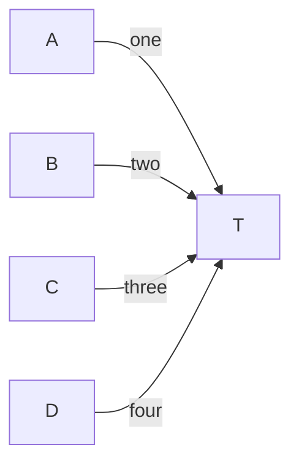
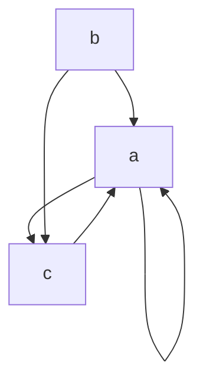

# Known differences from mermaid.js

Places where zombie-mermaid renders or parses differently from mermaid.js and the
difference is either intentional or not yet fixed. The reference is the pinned
`mermaid` devDependency (12.1.0), rendered headless through
`scripts/lib/real-mermaid.ts`; GitHub renders 12.1.0 and mermaid.live 12.2.0 (see the
table below).
The pin moved from 11.17.2 in the bump that added this note, and entries not
listed below as re-checked were measured on 11.17.2: other versions may differ.
The "Labeled Fan-In (LR)" mirrored-order entry that used to sit under layout
tie-breaks was removed after a re-check: on 12.1.0 mermaid and zombie-mermaid agree
(100% / 100%, it was 17% on 11.17.2).

## Which mermaid each surface renders (checked 2026-10-16, #2184)

| Surface                        | mermaid | Default layout | Evidence                                                                                                                   |
| ------------------------------ | ------- | -------------- | -------------------------------------------------------------------------------------------------------------------------- |
| Pinned oracle (`package.json`) | 12.1.0  | ELK            | `mermaid.mermaidAPI.getConfig().layout` is `elk` headless                                                                  |
| GitHub ` ```mermaid ` blocks   | 12.1.0  | ELK (config)   | Renderer bundle `viewscreen.githubusercontent.com/static/assets/mermaidMarkdown-*.js` matches 12.1.0, not 12.0.0 or 12.2.0 |
| mermaid.live                   | 12.2.0  | ELK            | The editor shows `v12.2.0`; node positions equal the headless ELK render                                                   |

GitHub's bundle reports `version:"0.0.0"` and its renderer sits in a cross-origin
iframe, so its version is inferred, not read: it contains identifiers added in 12.1.0
(`orientFeedbackEdges`, `applyOverride`) and none of the 12.2.0 additions
(`upperCaseDirection`, `isUnconnected`, `colorBy`). 12.1.0 and 12.2.0 place the dense
samples identically (gallery "Dense Duplicate Edges" TD and LR, and the #2160 sample 3
with and without `n0["n0"]`/`n1["n1"]` declarations), so the pin is a valid target on
both surfaces; `layout: dagre` places them differently. Re-run the check when the pin
moves; `tsx scripts/lib/mermaid-pin-freshness.ts` prints the last versions seen.

## Subgraph inner direction

Re-checked on 12.1.0 (and 11.17.2). Given `subgraph S` holding `a --> b --> c` in a
`graph TD`:

- **No `direction`.** mermaid 11.17.2 flipped an uncrossed subgraph perpendicular to
  its parent (row inside a `TD` graph). mermaid 12.1.0, mermaid.live and GitHub do
  not: the subgraph follows its parent (column). zombie-mermaid never flips, so it
  matches 12.x. A 11.x-based comparison shows a difference that is not one.
- **Explicit `direction`.** Both versions keep it unless an edge crosses the subgraph
  boundary, or an ancestor's. An edge to or from the subgraph's own id (`X --> S`,
  `S --> Y`) does not cross it, so `direction LR` plus `X --> S` is a row. An edge to
  or from a member (`X --> a`, `c --> Y`) crosses, and the subgraph follows its
  parent. zombie-mermaid counts the subgraph's own id as inside, so it draws a column
  for the id-edge cases (#1830 fixes this).

## Layout tie-breaks and placement

Since mermaid 12.0.0, mermaid.js lays out flowcharts, state, class and ER diagrams
with ELK by default (it was dagre in 11.x; see the
[12.0.0 release notes](https://github.com/mermaid-js/mermaid/releases/tag/mermaid%4012.0.0)),
and mermaid.live renders that layout. Both engines are now ELK, but with different
options: mermaid sets no `considerModelOrder` and breaks cycles depth-first, while
zombie-mermaid uses `considerModelOrder.strategy: NODES_AND_EDGES` (set in
`packages/svg-renderer/src/layout-engine/to-elk.ts`), so node order within a layer, and
cross-axis offsets between layers, can still differ even when both assign the same
layers. The 12.1.0 comparison is in
[#1834](https://github.com/dfadler/zombie-mermaid/issues/1834).

- **Sibling subgraph order and feedback edges.** zombie-mermaid still imitates
  mermaid 11's dagre layout in two places: sibling subgraphs are placed in reverse
  declaration order, and depth-first back edges are reversed before ELK runs. Mermaid
  12 does neither. "Nested Subgraphs" puts the second subgraph on the left in ours and
  the first on the left in mermaid 12.1.0 and mermaid.live (horizontal 20%), and in
  "CI/CD Pipeline" mermaid 12.1.0 keeps `Fix & Retry` beside `Build Image` where ours
  puts it below `QA Approved?` (horizontal 48%). Tracked in
  [#1904](https://github.com/dfadler/zombie-mermaid/issues/1904).
- **Remaining small differences are tie-breaks.** "System Architecture", "Flowchart:
  CJK Labels" and "LR Fan-In With Bypass Edge" score 33-93% against 12.1.0, but every
  disagreeing node pair is one renderer calling two centres level (within the 20 px
  tolerance) and the other offsetting them. In "LR Fan-In With Bypass Edge" `B` sits
  above `A` and `C` in both renderers, 22 px in mermaid (12.1.0 and 12.2.0) and 15 px
  in ours, whose boxes are 37 px tall to mermaid's 48 px (#2058). In "CJK Labels"
  mermaid puts `B` about 19 px below `A`, `C` and `D`, and ours puts it 29 px above.
  The cause is not CJK text measurement: the same graph written in ASCII differs the
  same way, and without the subgraph both renderers put `B` above. It needs a subgraph
  around `A` and `B` plus the feedback edge `C --> A`, so it is where the edge's track
  sits relative to `B`, not text width (#1941). "Flowchart: Five Cluster Exit Siblings (TD)"
  agreed only after `elk.spacing.edgeEdge` was raised to 40 px for graphs with three or
  more labelled edges between the same pair (#1943).
- **Three more flowchart samples sit under the default floor.** Node boxes are
  identical in mermaid 12.1.0 and 12.2.0 (12.2.0 from jsDelivr, headless Chromium);
  each got a floor just under its score on 2026-10-15 (#2058).
  - "LR Bypass Edge In A Chain" (50% vertical, floor 45%): the same tolerance split as
    "LR Fan-In With Bypass Edge". `B` is above `A`, `C` and `D` in both; 22 px in
    mermaid, 15 px in ours (37 px boxes to 48 px), so 3 of 6 pairs disagree.
  - "Dense Duplicate Edges (TD)" (67% horizontal, floor 65%) and "(LR)" (33% vertical,
    floor 30%): both put the nodes in the same order (TD: `b` left of `a`, `c` right of
    both; LR: `b` above `a`, `c` below) and ours is more compact. The disagreeing pairs
    are offsets under the 20 px tolerance in ours that mermaid draws wider: TD `c` is
    19 px right of `a` (30 px in mermaid), LR `b` is 19 px above `a` (26) and `c` 16 px
    below (29). The sample was added for ASCII routing (#2109), where it is not scored;
    as an SVG layout it is plausible next to mermaid's.

## State diagram notes

zombie-mermaid's parser reads `note left of X` / `note right of X` but ignores the side:
swapping the keywords gives byte-identical output, and placement comes from the layout
engine's dotted edge from the state to the note ([#2094](https://github.com/dfadler/zombie-mermaid/issues/2094)).
mermaid.js does not place notes on the named side either. Checked on mermaid 12.2.0
(jsDelivr, real Chrome, default config) for the "State: Notes" sample: `note right of
Active` lands below `Active`, 20 px to its left, and `note left of Idle` lands above
`Idle`, 20 px to its right. The maintainer-run oracle on 12.1.0 gives the same layout.
The remaining gap is layout tie-breaks, which is why "State: Notes" scores 83% horizontal
agreement; the floor in `scripts/lib/layout-agreement.ts` stays at 0.8
([#1942](https://github.com/dfadler/zombie-mermaid/issues/1942)). Not checked: mermaid.live
or GitHub for this sample.

## Escaped characters in pie titles

mermaid.js double-escapes `<`, `&` and `>` in a pie title: `pie title Labels <&> "quotes"`
renders the text `Labels &lt;&amp;&gt; "quotes"` (the entities appear literally; the
quotes are fine). Checked on mermaid 12.2.0 (jsDelivr, real Chrome) and on mermaid.live
(version not shown on the page), by reading the rendered title element's text. zombie-mermaid
renders the literal `Labels <&> "quotes"` and does not copy the bug. Duplicate slice
labels such as `"R&D"` keep the first value in both renderers
([#2084](https://github.com/dfadler/zombie-mermaid/issues/2084)).

## ASCII: several sources into one target share the target's face

Intentional ([#1826](https://github.com/dfadler/zombie-mermaid/issues/1826)). The ASCII
renderer gives each of several edges between the _same pair_ of nodes its own lane and
arrowhead (`assignParallelEdgeLanes`, `packages/ascii-renderer/src/edge-routing.ts`), and
lengthens the box face when there are more than three. Edges from _different sources_ into
one target are left out of that: they keep merging onto the target's face. Giving each
its own face cell would change `Labeled Fan-In (LR)` and widen every fan-in diagram. No
output target (charset, width, markdown profile, MCP) forces this; it is a choice.



- **zombie-mermaid (ASCII).** The four edges join into one trunk ending in a single
  arrowhead on `T` (`TD` does the same, one head per side). Each label stays on its own
  source's stroke, so every edge is still readable and attributable, but a reader cannot
  count four heads.
- **mermaid.js.** Four separate paths, each with its own arrowhead, stacked against the
  same face of `T`. The heads overlap and the stack looks cramped, but there are four.

Checked on mermaid 12.1.0 (the pinned `node_modules` build, rendered headless in Playwright
Chromium through `scripts/lib/real-mermaid.ts`; four `flowchart-link` paths, four
`marker-end` arrowheads, both `LR` and `TD`) and on the current renderer's ASCII output
(unicode charset). Not checked: mermaid 11.x, mermaid 12.2.0 or later, mermaid.live and
GitHub for this sample, the `ascii` charset, and fan-ins with more than the four sources
above.

## ASCII: a self-loop sits on the flow-side faces, not where mermaid puts it

Not fixed ([#2101](https://github.com/dfadler/zombie-mermaid/issues/2101)). Mermaid
12.1.0 and 12.2.0 (and mermaid.live, which runs 12.2.0) draw `a --> a` as a small loop on
the node's **left** face in `TD` and `BT`, and on its **top** face in `LR` and `RL`,
alone or beside other edges. The ASCII renderer draws it on the flow-side faces: out of
the bottom and back in at the right in `TD`/`BT`, out of the right and back in at the
bottom in `LR`/`RL` (`selfReferenceDirection`, `edge-routing.ts`).



- **Why not moved.** The left (`TD`/`BT`) or top (`LR`/`RL`) face of a node in the first
  grid column or row has no gutter beside it, so the layout would have to grow a leading
  column or row for it, and in the middle of a diagram that face is usually another
  edge's. The loop's legs, its arrowhead cell, duplicate loops, hugging a neighbour's lane
  (`hugLoop`, #2025/#2070) and labelled loops are all built around the current faces, so
  the move touches every self-loop, for a difference in where a small loop is drawn.
- **What does hold.** The loop shares no stroke with another edge ([#2098](https://github.com/dfadler/zombie-mermaid/pull/2098)),
  and the edges around it get a stroke and an arrowhead each ([#2100](https://github.com/dfadler/zombie-mermaid/issues/2100)).
- **Layout.** The two samples sit under the default 85% oracle floor for a placement
  reason that has nothing to do with the loop: mermaid staggers the three nodes
  (`SAMPLE_FLOORS`, `scripts/lib/layout-agreement.ts`).

Checked on mermaid 12.1.0 and 12.2.0 (headless Playwright) and mermaid.live (12.2.0, `TD`
only); GitHub's render was not reachable. See the comment on #2101 for the numbers.

## Class: lollipop interfaces

Not a difference any more for one-ended lollipops
([#2117](https://github.com/dfadler/zombie-mermaid/issues/2117),
[#2135](https://github.com/dfadler/zombie-mermaid/issues/2135)): `A ()-- B` / `B --() A` draw
the name beside a small circle joined to `B` by a stem, with no `A` box unless `A` has
members, an annotation, another relationship, a note or a namespace, in both SVG and ASCII,
as mermaid.js does (12.1.0 and 12.2.0 agree). `()--()` is an ordinary boxed line with a
circle at both ends, in mermaid and here.

Dotted lollipops (`()..`, `..()`), which mermaid accepts, are a parse error here.

## Class: LR and RL in ASCII

Class diagrams with `direction LR` or `direction RL` are drawn in ASCII like the SVG, with
each level in a column and `RL` as the mirror
([#2158](https://github.com/dfadler/zombie-mermaid/issues/2158); mermaid.js 12.1.0 and 12.2.0
agree on the arrangement). The top-down and `BT` drawings are the class renderer's own level
rows; `LR` and `RL` are lowered onto the flowchart ASCII grid instead (classes become boxed
nodes, relationships become edges, namespaces become frames), so a few things follow the
flowchart, not mermaid:

- Boxes in a column share one width and boxes on a row share one height; the extra rows stay
  empty at the bottom of the last compartment (a box with one compartment is centred).
  mermaid.js keeps each box at its own size.
- A parent with several children leaves by one face and branches off a shared trunk, instead
  of one line per child from the parent's flow-side face.
- A line that meets a box side on a compartment divider row is joined to it (`┼`); it can
  look as if it crosses the box.
- Namespace frames, labels and routing around obstacles are the flowchart's, so they differ
  in detail from the top-down class drawing.

`RenderOptions.direction` still does not apply to class diagrams.

## `themeVariables` are opt-in, and only a subset

Decided in [#2108](https://github.com/dfadler/zombie-mermaid/issues/2108).
Mermaid applies `%%{init: {"themeVariables": {...}}}%%`; zombie-mermaid ignores it
unless the caller sets `honorThemeVariables: true`, because the colours of a
diagram should come from the host's `bg`/`fg` theme, not from text inside the
diagram. Checked on mermaid 12.1.0 and 12.2.0 (headless Chromium, computed
paint, identical results):

| Input                                                                                             | mermaid.js 12.1.0 / 12.2.0              | zombie-mermaid                                   |
| ------------------------------------------------------------------------------------------------- | --------------------------------------- | ------------------------------------------------ |
| `theme: base` + `primaryColor`, flowchart                                                         | node fill follows it                    | ignored; with the option: node fill (`surface`)  |
| `primaryColor` under the default, `dark`, `forest`, `neutral` themes                              | ignored                                 | same                                             |
| `primaryTextColor`, `primaryBorderColor` (`base`)                                                 | text colour; start of a border gradient | ignored; with the option: `fg`; a solid `border` |
| `lineColor`, any theme                                                                            | edge and arrowhead colour               | ignored; with the option: `line`                 |
| `pie1`..`pie12`, any theme                                                                        | the Nth slice in source order, wrapping | ignored; with the option: same                   |
| invalid `primaryColor` (`#12345`)                                                                 | throws `Unsupported color format`       | ignored, renders                                 |
| invalid `pie1` (`notacolor`)                                                                      | slice painted `#333`                    | ignored, theme colour kept                       |
| `secondaryColor`, `tertiaryColor`, `background`, `fontFamily`, `nodeBorder`, `pie*TextColor`, ... | applied or used to derive other colours | not supported, listed in `InitConfig.ignored`    |

Mermaid derives many colours from `primaryColor` (secondary/tertiary, subgraph
fill, the border gradient, the other pie slices); zombie-mermaid does not, so a
`base` diagram with only `primaryColor` set does not look the same in both. Only
flowchart, state and pie read the directive. Details and the opt-in table:
[Configuration directives](diagrams.md#themevariables-opt-in).

## ASCII: opt-in layout-faithful mode (`--layout mermaid`)

The default ASCII renderer lays flowcharts out on its own grid, so node order and spacing
differ from mermaid's. `zombie-mermaid render <file> --ascii --layout mermaid` (library:
`renderMermaidASCIIWithLayout(src, { layout: 'mermaid' })` from `zombie-mermaid/ascii-layout`)
instead draws mermaid's own ELK layout (`packages/elk-layout`, `packages/ascii-layout`; #2177).
Opt-in only: without the flag the output is byte-identical to before.

- **Fallback, never silent.** Subgraphs, shapes the layout does not model, non-flowchart
  diagrams, a layout error, or a missing `elkjs-0.9.3` make it use the standard renderer; the
  CLI prints `layout-faithful: <reason>; used standard renderer` on stderr and the API returns
  `path: 'standard'` plus `fallbackReason`. On success stderr says `layout-faithful: used
  mermaid's ELK layout` and the result carries a `note`.
- **Width cap and fallback.** The drawing is capped at 120 columns (`--max-width <n>` /
  `maxCols` sets another cap): blank gaps between node groups are shrunk to fit, boxes never
  are. A diagram whose boxes alone exceed the cap (e.g. a long LR chain of wide labels) falls
  back to the standard renderer by default, with `layout-faithful: layout-faithful output is N
  columns, over the 120-column cap; used standard renderer` on stderr (API: `fallbackReason`).
  To get the wide layout-faithful text anyway, use `--layout mermaid-wide` (API:
  `maxCols: Infinity`).
- **Merged lines hide edge multiplicity.** Identical parallel edges draw as one line (three
  `A --> B` look like one).
- **Plain drawing at a fixed scale.** `-x/-y/-p`, `--coords`, `--theme` colors, `--hyperlinks`
  and `--max-width` compaction (it is the column cap instead) do not apply to it (they apply to a fallback render).
- **Pinned to mermaid 12.1.0 + elkjs 0.9.3.** The layout is only faithful to that pair. When
  the `mermaid` pin moves, re-run `pnpm run elk-layout:oracle` and update the module.
- **Dependency.** `elkjs-0.9.3` (`npm:elkjs@0.9.3`) is an optional peer dependency of
  `zombie-mermaid`, kept separate from the `elkjs` 0.11/0.12 the SVG renderer uses. The layout
  code is bundled into lazy chunks that load only when the option is used. The MCP tool does not
  expose it.

## Known limitations (not intentional, not yet fixed)

## ER diagrams

zombie-mermaid's ER parser (`packages/mermaid-parser/src/er/parser.ts`) is a
line-oriented parser rather than mermaid.js's grammar, so it is more lenient in
some places and stricter in others.

**Unquoted labels that start with a keyword.** Everything after `:` is the label here.
mermaid.js lexes a leading `one`, `many` or `to` as a word-form cardinality keyword
and rejects the line:

| Label                                                        | mermaid.js 11.17.2 | zombie-mermaid |
| ------------------------------------------------------------ | ------------------ | -------------- |
| `one-to-one`, `many-to-many`, `one`, `many`, `to` (unquoted) | parse error        | renders        |
| `"one-to-one"`, `"many-to-many"` (quoted)                    | parses             | renders        |
| `opt-to-many` (unquoted)                                     | parses             | renders        |

Quote such labels (`: "one-to-one"`) if the source also has to work in mermaid.js
tools such as GitHub or the Mermaid Live Editor.
