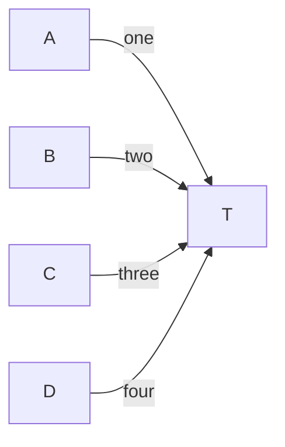
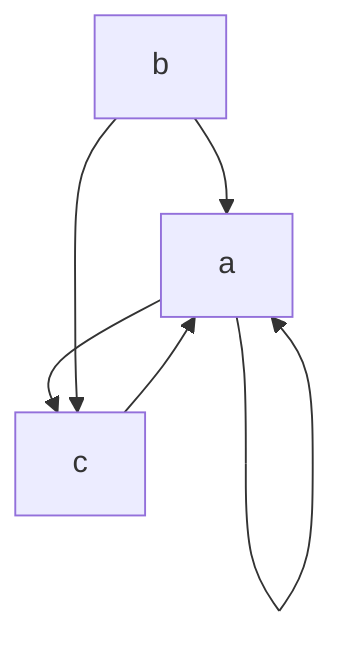

# Known differences from mermaid.js

Places where zombie-mermaid renders or parses differently from mermaid.js and the
difference is either intentional or not yet fixed. The reference is the pinned
`mermaid` devDependency (12.2.0), rendered headless through
`scripts/lib/real-mermaid.ts`; GitHub renders 12.1.0 and mermaid.live 12.2.0 (see the
table below). The pin matches mermaid.live, not GitHub.
The pin moved from 11.17.2 in the bump that added this note, and entries not
listed below as re-checked were measured on 11.17.2: other versions may differ.
The "Labeled Fan-In (LR)" mirrored-order entry that used to sit under layout
tie-breaks was removed after a re-check: on 12.1.0 mermaid and zombie-mermaid agree
(100% / 100%, it was 17% on 11.17.2).

## Which mermaid each surface renders (checked 2026-10-22, #2184)

| Surface                        | mermaid | Default layout | Evidence                                                                                                                   |
| ------------------------------ | ------- | -------------- | -------------------------------------------------------------------------------------------------------------------------- |
| Pinned oracle (`package.json`) | 12.2.0  | ELK            | `mermaid.mermaidAPI.getConfig().layout` is `elk` headless                                                                  |
| GitHub ` ```mermaid ` blocks   | 12.1.0  | ELK (config)   | Renderer bundle `viewscreen.githubusercontent.com/static/assets/mermaidMarkdown-*.js` matches 12.1.0, not 12.0.0 or 12.2.0 |
| mermaid.live                   | 12.2.0  | ELK            | The editor shows `v12.2.0`; node positions equal the headless ELK render                                                   |

GitHub's bundle reports `version:"0.0.0"` and its renderer sits in a cross-origin
iframe, so its version is inferred, not read: it contains identifiers added in 12.1.0
(`orientFeedbackEdges`, `applyOverride`) and none of the 12.2.0 additions
(`upperCaseDirection`, `isUnconnected`, `colorBy`). 12.1.0 and 12.2.0 place the dense
samples identically (gallery "Dense Duplicate Edges" TD and LR, and the #2160 sample 3
with and without `n0["n0"]`/`n1["n1"]` declarations), so either version is a valid target on
both surfaces; `layout: dagre` places them differently. Re-run the check when the pin
moves; `tsx scripts/lib/mermaid-pin-freshness.ts` prints the last versions seen.

## Subgraph inner direction

Re-checked on 12.1.0 (and 11.17.2). Given `subgraph S` holding `a --> b --> c` in a
`graph TD`:

- **No `direction`.** mermaid 11.17.2 flipped an uncrossed subgraph perpendicular to
  its parent (row inside a `TD` graph). mermaid 12.1.0, mermaid.live and GitHub do
  not: the subgraph follows its parent (column). zombie-mermaid never flips, so it
  matches 12.x. A 11.x-based comparison shows a difference that is not one.
- **Explicit `direction`.** Both versions keep it unless an edge crosses the subgraph
  boundary, or an ancestor's. An edge to or from the subgraph's own id (`X --> S`,
  `S --> Y`) does not cross it, so `direction LR` plus `X --> S` is a row. An edge to
  or from a member (`X --> a`, `c --> Y`) crosses, and the subgraph follows its
  parent. zombie-mermaid counts the subgraph's own id as inside, so it draws a column
  for the id-edge cases (#1830 fixes this).

## Layout tie-breaks and placement

Since mermaid 12.0.0, mermaid.js lays out flowcharts, state, class and ER diagrams
with ELK by default (it was dagre in 11.x; see the
[12.0.0 release notes](https://github.com/mermaid-js/mermaid/releases/tag/mermaid%4012.0.0)),
and mermaid.live renders that layout. Both engines are now ELK, but with different
options: mermaid sets no `considerModelOrder` and breaks cycles depth-first, while
zombie-mermaid uses `considerModelOrder.strategy: NODES_AND_EDGES` (set in
`packages/svg-renderer/src/layout-engine/to-elk.ts`), so node order within a layer, and
cross-axis offsets between layers, can still differ even when both assign the same
layers. The 12.1.0 comparison is in
[#1834](https://github.com/dfadler/zombie-mermaid/issues/1834).

- **Sibling subgraph order and feedback edges.** zombie-mermaid still imitates
  mermaid 11's dagre layout in one place: depth-first back edges are reversed before
  ELK runs, which mermaid 12 does not do. Sibling subgraphs tied by an edge now keep
  declaration order ([#1982](https://github.com/dfadler/zombie-mermaid/pull/1982)), so
  "Nested Subgraphs" is 100% horizontal. The remaining difference is in "CI/CD Pipeline",
  where mermaid 12.1.0 keeps `Fix & Retry` beside `Build Image` and ours puts it below
  `QA Approved?` (horizontal 90% before the dead-band below, 100% after). Tracked in
  [#1904](https://github.com/dfadler/zombie-mermaid/issues/1904).
- **Remaining small differences are tie-breaks.** "System Architecture" scores 89%
  vertical against 12.2.0 (node-size tie-break, #2058) and is the accepted remaining
  difference; "Flowchart: CJK Labels" is 100% since #2358. Every
  disagreeing node pair is one renderer calling two centres level (within the 20 px
  tolerance) and the other offsetting them. In "LR Fan-In With Bypass Edge" `B` sits
  above `A` and `C` in both renderers, 22 px in mermaid (12.1.0 and 12.2.0) and 15 px
  in ours, whose boxes are 37 px tall to mermaid's 48 px (#2058). "CJK Labels"
  used to differ too (mermaid put `B` about 19 px below `A`, `C` and `D`, ours 29 px above):
  with the feedback edge `C --> A` reversed, its track sat on the wrong side of `B`. Listing
  subgraph feedback edges first in the ELK edge order fixes it (100% on 12.1.0, #2358; the
  issue was #1941).
  "Flowchart: Five Cluster Exit Siblings (TD)"
  agreed only after `elk.spacing.edgeEdge` was raised to 40 px for graphs with three or
  more labelled edges between the same pair (#1943).
- **The 20 px tolerance has a dead-band.** A fixed cut-off split pairs whose offsets
  sat on either side of it ("LR Bypass Edge In A Chain": 15 px in ours, 22 px in
  mermaid, from 37 px against 48 px boxes). A pair now also agrees when both layouts'
  offsets are within 10 px of the tolerance and point the same way (`TOLERANCE_BAND`).
  Measured on mermaid 12.1.0 across all 105 samples: 29 of 1802 pair-axes disagreed,
  13 of them such splits; the band clears 15 and moves no sample under its floor. The
  bypass, "Dense Duplicate Edges (LR)", "Self-Loop ... (LR)" and "CI/CD Pipeline"
  samples now score 100%. "Dense Duplicate Edges (TD)" (`c` 18.5 px right of `a`, 30.1 px in
  mermaid, 0.1 px outside the band) and "Self-Loop ... (TD)" (mermaid staggers 48 and 37 px, ours stacks) stay
  under the default floor.
  A fixed 15, 25 or 30 px tolerance, or one scaled by node height, only moved the
  cliff or split other samples; marking samples "oracle n/a" would not reach the
  non-ASCII ones (#2155).

## State diagram notes

mermaid 12.3.0 joins a note to its state with a dotted, arrowless edge whose direction follows
the side keyword: `note right of X` is `X -> note`, `note left of X` is `note -> X`. So a
right note ranks below its state and a left note above it. zombie-mermaid does the same
([#2829](https://github.com/dfadler/zombie-mermaid/issues/2829)); "State: Notes" scores 100%
vertical and horizontal agreement on 12.3.0 and has no sample floor. Before that it ignored the
side (both notes hung below), which scored 83% horizontal. Both renderers share the parse.

## Sequence SVG: self-message and lifeline spacing ([#2477](https://github.com/dfadler/zombie-mermaid/issues/2477))

Measured against mermaid 12.2.0 (the latest on npm, 2026-10-31) via `scripts/lib/real-mermaid.ts`.
Matched: the self-message loop is mermaid's cubic path (`M x,y C x+60,y-10 x+60,y+30 x,y+20`),
the label is centred on the lifeline, the extra drop after a self-message is 30 px, and the
lifeline is not cut around a self-message label.

Not matched:

- **Scale.** mermaid lays out at 16 px text with 74 px actor boxes: rows are 46 px apart and
  the label centre sits 15 px above its arrow. Here the text is 11 px, actors 40 px, rows 40 px
  and the rise 10 px. The loop and the 30 px drop are mermaid's absolute sizes, so a self-message
  looks slightly larger against the text than in mermaid.

Lifelines are no longer cut around message, block-tab or `else`/`and` labels: like mermaid
12.3.0, each is one straight line ([#2706](https://github.com/dfadler/zombie-mermaid/issues/2706)).

## Sequence: `%%{init}%%` options and `link`/`links` ([#2589](https://github.com/dfadler/zombie-mermaid/issues/2589))

Measured on mermaid 12.3.0 (headless Chromium, `%%{init: {"sequence": {...}}}%%` over a
three-message sample, viewBox compared with the default).

Honoured: `mirrorActors: false` (no participant row under the lifelines, SVG and ASCII) and
`showSequenceNumbers: true` (numbers messages like `autonumber`) and
`hideUnusedParticipants: true` (drops a participant no message, `activate` or note names; a
`box` membership alone does not keep it).

Layout keys (#2703), checked against mermaid 12.3.0 by rendering each key and reading the
rects and text anchors. This renderer lays out at its own scale (16 px text in mermaid, 11 px
here), so each size or margin key moves our constant by its distance from mermaid's default
(`actorMargin: 100` moves the second lifeline 50 px, as in mermaid); a key at its default, or
absent, changes nothing.

| Option                                     | SVG                                                      | ASCII                                     |
| ------------------------------------------ | -------------------------------------------------------- | ----------------------------------------- |
| `wrap` (with `width`, `actorMargin`)       | notes wrap at `width`, messages at `width + actorMargin` | same, at 8 px a column                    |
| `noteAlign`, `messageAlign` `left`/`right` | text-anchor start/end                                    | text sits at that side                    |
| `actorMargin`, `width`, `height`           | lifeline gap, box width, box height                      | no analogue (character cells)             |
| `boxMargin`, `noteMargin`                  | row spacing, note padding                                | no analogue                               |
| `rightAngles`, `activationWidth`           | square self loop, bar width                              | loop is already square; no width analogue |
| `diagramMarginX/Y`, `bottomMarginAdj`      | outer padding                                            | no analogue                               |

Nothing to honour: mermaid 12.3.0 itself ignores `actorFontSize`, `messageFontSize`,
`noteFontSize` (text stays 16 px) and `messageMargin` (rows do not move), so we match by
ignoring them. Per-message and per-note `wrap:` / `nowrap:` prefixes are honoured (they override
`wrap`, and are not drawn); on a participant name the prefix is dropped but the name is not wrapped
(#2783). A block tab or divider label word wider than the frame splits mid-word with a `-`, as
mermaid's `breakString` does (#2773).

`link` / `links` (participant menus): measured on mermaid 12.3.0, the menu is a
`display="none"` `actorPopupMenu` group with `<a xlink:href>` entries that only a click in a
browser opens; the viewBox is identical with and without it. Nothing visible changes in a
static image, so the line is parsed and dropped (also `properties` and `details`).

## Escaped characters in pie titles

mermaid.js double-escapes `<`, `&` and `>` in a pie title: `pie title Labels <&> "quotes"`
renders the text `Labels &lt;&amp;&gt; "quotes"` (the entities appear literally; the
quotes are fine). Checked on mermaid 12.2.0 (jsDelivr, real Chrome) and on mermaid.live
(version not shown on the page), by reading the rendered title element's text. zombie-mermaid
renders the literal `Labels <&> "quotes"` and does not copy the bug. Duplicate slice
labels such as `"R&D"` keep the first value in both renderers
([#2084](https://github.com/dfadler/zombie-mermaid/issues/2084)).

## Pie charts

Found in the #1592 snapshot audit and re-checked on mermaid 12.2.0 (the pin, which is
also the latest on npm) for #2314; the audit also checked 12.1.0, what GitHub renders.

- **Palette.** zombie-mermaid colours slices with a blue/teal scale derived from the
  theme accent; mermaid uses its pastel `pie1`..`pie12` scale (`#ECECFF`, `#ffffde`, ...).
  `themeVariables` `pie1`..`pie12` are honoured only when opted in (see the
  `themeVariables` section below).
- **Tall legend.** A legend taller than the 450px frame (about 20 slices or more) is
  clipped at the top and bottom, as in mermaid 12.3.0: the viewBox height stays 450 and
  the rows outside it are cut off. A legend wider than the frame (top, bottom or center
  with very long labels) is clipped the same way: the viewBox keeps its 490px width
  ([#2781](https://github.com/dfadler/zombie-mermaid/issues/2781)); left and right grow it.
  The ASCII table still lists every slice
  ([#2722](https://github.com/dfadler/zombie-mermaid/issues/2722)).
- **Empty pie.** When every slice is zero, zombie-mermaid draws no slice paths and one
  outline circle, matching mermaid 12.3.0 (0 paths, 1 circle; only the legend width differs
  by a few pixels, [#2826](https://github.com/dfadler/zombie-mermaid/issues/2826)).
- **ASCII legend.** Mermaid has no ASCII output. The table lists every slice with its
  share of the whole total, including slices that get no bar cell (under 1%, or past the
  bar's 50-cell budget); a nonzero share that rounds to 0% reads `<1%`
  ([#2313](https://github.com/dfadler/zombie-mermaid/issues/2313)).

## Quadrant charts

Checked on mermaid 12.2.0 (the pin, also npm `latest`). `pnpm run quadrant:oracle`
renders every `Quadrant:` sample through real mermaid and compares rect, line, circle and
text positions with `layoutQuadrantChart`; they match exactly, and the weekly layout-oracle
workflow fails on a drift (`packages/svg-renderer/src/__tests__/quadrant-svg.test.ts` also
pins the campaigns numbers). Colours (below) are not compared; empty quadrant labels are (checked on 12.3.0).

- **Point colour.** Mermaid 12.2.0's default theme emits `fill="hsl(240, 100%, NaN%)"`
  for every point without a `color`, which browsers drop, so mermaid.live and GitHub show
  near-black dots. zombie-mermaid draws them in `var(--fg)`: the same dot on a light
  theme, still visible on a dark one. A point's own `color`, `stroke-color` and
  `stroke-width` (or its class's) are drawn as written.
- **Palette.** Cell fills are the theme accent mixed into the background at four falling
  strengths; mermaid uses lavender steps from its `primaryColor`.
- **Text widths.** Neither renderer measures text; this library's font is not mermaid's
  `trebuchet ms`, so a long label overflows at a slightly different point.
- **Init config and theme variables.** The `quadrantChart` block of `%%{init}%%`
  (`chartWidth`, `chartHeight`, the paddings and font sizes, `pointRadius`,
  `xAxisPosition`, `yAxisPosition`, the border stroke widths) is applied as mermaid
  does, checked against 12.2.0; a non-number, negative number or unknown position is
  dropped. The `quadrant*Fill`, `quadrant*TextFill`, `quadrantPoint*`, axis text, title
  and border `*StrokeFill` variables are read under any theme, like mermaid, but only
  with `honorThemeVariables` ([themeVariables](diagrams.md#themevariables-opt-in)).
  ASCII ignores both. Mermaid's other theme-derived colours are not computed.
- **Empty labels.** Like mermaid 12.3.0, a quadrant with no label gets an empty `<text>`
  at the position a label would have; axis, point and title text are dropped when empty,
  in both.
- **ASCII.** Mermaid has no ASCII output. The x axis is always below the grid (mermaid's
  SVG puts it on top of a chart with no points), and point labels are in a legend, not
  next to the markers.

## Mindmaps

Checked on mermaid 12.3.0 (npm `latest`, 2026-11-06), 12.2.0 (the pin, mermaid.live) and
12.1.0 (what GitHub renders, #2184): the three place the sample mindmaps identically
(node positions equal to the last digit). `pnpm run mindmap:oracle` renders every `Mindmap:`
sample through real mermaid and compares structure (text, shape, section, classes, parents,
edge classes) exactly, our shape sizes from mermaid's measured label boxes, and our
layout and edge paths from mermaid's measured node sizes (0.01px); the weekly layout-oracle
workflow fails on a drift. The layout is a dependency-free port of the CoSE-Bilkent force
layout mermaid runs through cytoscape, bit-identical to it for a tree.

Mermaid's layout itself is not reproducible across JavaScript engines for some inputs: V8's
`Math.pow` changed its last digit between the V8 versions of the two Node releases CI runs, which is enough to rearrange
`Mindmap: Many Branches` (12 leaves on one root). The port tabulates the one `pow` it needs
with the newer V8's values (current Chromium's), so it renders the same on every Node version and
agrees with a current Chromium; a browser with an older V8 can draw such a mindmap
differently in mermaid itself.

- **Label widths, and so positions.** Mermaid measures labels in "trebuchet ms"; this
  library uses its own font's metrics. Node sizes differ by the text-width difference and,
  the layout being a physics simulation, node positions move with them: a gallery sample with
  similar-sized leaves (`Mindmap: Shapes`) comes out with the same shapes and sections but the
  leaves arranged around the root in a different order, as it would with another font in
  mermaid itself. The oracle feeds the layout mermaid's
  own sizes, so it measures the algorithm, not the font.
- **Colours.** Sections use the theme accent and its shades mixed into the background (root
  in the foreground colour), not mermaid's default-theme hsl palette with black or white
  labels. The underline of the default shape follows its section colour.
- **Icons.** `::icon()` is parsed and kept on the node; mermaid 12.3.0 draws nothing for
  it without an icon font (a node with an icon only gets a `labelBkg` class), and neither
  do we. `:::class` names are added to the node's `class` attribute, but there is no
  stylesheet to define them.
- **Not read.** The `mindmap` block of `%%{init}%%` (`padding`, `maxNodeWidth`, `colorBy`),
  `layout`, `look` and the theme variables. Labels keep bold, italic and line breaks;
  other HTML tags are dropped.
- **Empty and header-only.** `mindmap` followed only by blank lines renders nothing in
  mermaid; here it is a parse error naming the missing node.
- **ASCII.** Mermaid has no ASCII output. The tree is indented rather than radial, and a
  node's shape shows as its delimiters.

## Gantt charts

Checked on mermaid 12.3.0 (npm `latest`; mermaid.live's 12.2.0 renders the same
figures). `pnpm run gantt:oracle` renders every `Gantt:` sample through real mermaid
and compares exclude ranges, stripes, bars, task-label rows and classes, axis ticks
and labels, section labels and the title with `layoutGantt` at the same width; they
match exactly, and the weekly layout-oracle workflow fails on a drift.

- **Width.** Mermaid sizes the chart to its container (and fills it with
  `width="100%"`); this library draws a fixed 1200px frame, Mermaid's own fallback.
  The oracle compares at 1264, the headless page's width.
- **Time zone.** Mermaid reads and draws dates in the viewer's time zone; this library
  uses UTC. They differ only for charts spanning a daylight-saving change (a day is
  then 23 or 25 hours there, shifting bars by a pixel) and for a date `dateFormat`
  does not match, which is read by `new Date()`.
- **`topAxis`.** Mermaid 12.3.0 (and 12.2.0) fails on the `topAxis` statement with
  `TopAxis is not a function` (the grammar calls a method ganttDb does not have),
  so there is nothing to match; the statement works here, and the `topAxis` config
  key works in both.
- **Today line.** Mermaid always draws it; here it is drawn only while today is
  inside the chart's dates, so a chart in the past or future is byte-stable.
- **Task labels.** Whether a label sits inside its bar, or to its right or left,
  depends on its measured width, which differs between this library's font and
  mermaid's `trebuchet ms`; the oracle reports such a difference as a note, not a
  mismatch. Labels are trimmed (Mermaid keeps trailing blanks, which SVG collapses).
- **Palette.** Colours come from the theme (accent bars, foreground-tinted done
  tasks and grid); the third section keeps Mermaid's yellow stripe and critical tasks
  keep its red. Mermaid's other theme-derived colours are not computed.
- **Ids.** Mermaid gives each bar and label an `id` made of the diagram id and the
  task id, which collide when two diagrams share a page; here they are
  `data-task` attributes, and exclude ranges carry `data-date`.
- **Unscheduled tasks.** A task whose `after` chain never resolves (a cycle), or
  whose first task has no start date, is a parse error here; Mermaid renders a
  broken chart.
- **Config.** The `gantt` keys of `%%{init}%%` that change what is drawn are read
  (see [Gantt Charts](diagrams.md#gantt-charts)); sizes (`barHeight`, `barGap`,
  `topPadding`, `leftPadding`, `rightPadding`, `fontSize`, `numberSectionStyles`,
  `useWidth`) are ignored.
- **`excludes` at the end of a chart.** A run of excluded days still open at the
  last day is not shaded, as in Mermaid.
- **ASCII.** Mermaid has no ASCII output; see [ASCII Gantt Charts](diagrams.md#ascii-gantt-charts).

## XY charts

Found in the #1592 snapshot audit and re-checked on mermaid 12.2.0 for #2314 (the audit
also covered 12.1.0). Unless noted, these are choices, not bugs.

- **SVG styling.** Matches mermaid 12.3.0 ([#2857](https://github.com/dfadler/zombie-mermaid/issues/2857)):
  square bars, no legend, and a second bar series drawn over the first. Lines are straight
  segments with no point markers, there is no grid, and each axis has a line and tick marks
  (mermaid has no option for curved lines in 12.2.0, 12.3.0 or on `develop`).
- **Bar thickness.** Bars follow mermaid 12.2.0's band formula ([#2515](https://github.com/dfadler/zombie-mermaid/issues/2515)):
  95% of the smaller of twice the axis padding and the tick distance. Mermaid pads by
  half the widest category label as it measures it in the browser, on a plot about 660 px
  wide; ours estimates the text on a 600 px plot, so with long labels (the Product Sales
  sample) a bar's share of the spacing can differ by up to about 0.13. The oracle allows 0.15.
- **Numeric x-axis range.** SVG uses mermaid's linear axis: a label at every d3 tick,
  points placed by value, a horizontal chart's range running bottom-up
  ([#1592](https://github.com/dfadler/zombie-mermaid/issues/1592)). The ASCII renderer
  has its own layout and still treats the range as evenly spaced labels at the data
  points, so `0 --> 100` with 5 bars labels 0, 25, 50, 75, 100 there.
- **Unquoted titles and labels drop their spaces, as in mermaid 12.3.0.** `title Week 1 sales`
  reads `Week1sales`, `x-axis [New Users]` reads `NewUsers`, `y-axis Y Z 0 --> 5` reads `YZ`
  (letters and digits only for titles; categories also allow `+ = * # _ . & -`). A one-word
  `x-axis Foo [a, b]` title works; `x-axis Foo Bar [a, b]` is rejected by mermaid and is
  not special-cased here. Quote a label (`"New Users"`) to keep its spaces.
- **Rejected input fails with our own error text, not mermaid's** ([#2785](https://github.com/dfadler/zombie-mermaid/issues/2785), checked against mermaid 12.3.0). Both reject the same sources (`x-axis [a;b, c]`, `x-axis [/users, b]`, `x-axis [a, , b]`, `x-axis [a, b`, `bar [1, x, 3]`, `bar [1, 2`, `line [1,,3]`, `title "unclosed`, `y-axis 0 --> x`, `bar 1,2,3`); nothing renders either way. Mermaid's message is its jison lexer/parser text: `Parse error on line N:`, a clipped source excerpt with a caret, and `Expecting 'SQUARE_BRACES_END', 'COMMA', got 'SEMI'` (or `Lexical error on line N. Unrecognized text.`). The expected-token list comes from its LALR tables and the excerpt is not reliable (it runs the header into the first line, `...chart-betax-axis [a;b, c]`), so it is not reproduced. Ours is `Line N: ...` naming the directive or value and what is allowed. Tools that match on mermaid's message text will not match ours. One accept/reject difference is not about text: `x-axis [a, b] extra` is rejected by mermaid (`got 'ALPHA'`) and accepted here, the trailing text ignored.
- **Negative bars.** Mermaid 12.2.0 draws a bar from the bottom of the axis, so a negative
  value gives a bar that starts at the axis minimum; zombie-mermaid draws from 0, the
  correct reading (a known mermaid quirk).
- **Value-axis padding and x labels match mermaid in SVG only; flat data matches in both**
  ([#2567](https://github.com/dfadler/zombie-mermaid/pull/2567), checked on mermaid 12.2.0;
  flat data in ASCII: [#2727](https://github.com/dfadler/zombie-mermaid/issues/2727), checked
  on mermaid 12.3.0). The value axis keeps half a label's height (half its width, horizontally)
  of padding inside its line, so the smallest bar and the lowest line point stay visible. A flat
  series (`bar [42]`, `[0, 0, 0]`: every value across all series equal, with no explicit
  `y-axis` range) gets one tick in the middle of the axis, as mermaid does, in both SVG and ASCII.
  Differing flat series (`bar [42, 42]` with `line [10, 10]`) and explicit ranges keep several ticks. Every x-axis category is labelled, even when neighbouring labels touch,
  as mermaid does (the #1243 thinning is gone from SVG). The ASCII renderer has its own layout
  and is unchanged there: it still thins crowded labels.
- **ASCII category labels widen the chart; they are never cut** ([#2698](https://github.com/dfadler/zombie-mermaid/issues/2698), checked against mermaid 12.3.0). Mermaid prints every category in full on a plot of fixed width and lets neighbours overlap; it does not truncate or rotate (`Engineering`, `ProductManagement`, `CustomerSuccess`, `HumanResources` in the long-label gallery sample). A terminal cannot overlap text, so the ASCII renderer widens every band until no two neighbouring words touch (one blank cell between them). A 60-column plot gives each of up to 10 categories `60 / n` columns, and `6` columns each beyond that; the bands only grow once a word label leaves less than one blank cell to its neighbour, so eight categories fit labels up to 6 characters and `Marketing` makes the whole chart wider. The chart is as wide as its labels need, with no cap. Numbers and dates are still thinned (every n-th shown) rather than widening the chart, where mermaid shows them all. Words in a horizontal chart already get a gutter as wide as the longest label.
- **ASCII y-axis.** Mermaid has no ASCII output. The plot is 20 rows tall, fewer than
  mermaid's ~10 d3 ticks need once they round to rows, so the renderer labels every Nth
  tick (the smallest N that leaves an unlabeled row between labels) rather than putting
  labels on adjacent rows
  ([#2310](https://github.com/dfadler/zombie-mermaid/issues/2310)).

## ASCII: LR/RL sibling gap is `paddingY - 1` ([#2350](https://github.com/dfadler/zombie-mermaid/issues/2350))

Intentional. In LR (and RL) layouts the blank-row gap between sibling nodes is `paddingY - 1` (never below 1),
4 rows at the default of 5, against mermaid 12.2.0's 40 px gap between 48 px nodes. TD keeps
`paddingY` as is. Because of the offset, `-y 5` no longer gives the old LR gap; pass `-y 6`
for it.

## ASCII: several sources into one target share the target's face

Intentional ([#1826](https://github.com/dfadler/zombie-mermaid/issues/1826)). The ASCII
renderer gives each of several edges between the _same pair_ of nodes its own lane and
arrowhead (`assignParallelEdgeLanes`, `packages/ascii-renderer/src/edge-routing.ts`), and
lengthens the box face when there are more than three. Edges from _different sources_ into
one target are left out of that: they keep merging onto the target's face. Giving each
its own face cell would change `Labeled Fan-In (LR)` and widen every fan-in diagram. No
output target (charset, width, markdown profile, MCP) forces this; it is a choice.



- **zombie-mermaid (ASCII).** The four edges join into one trunk ending in a single
  arrowhead on `T` (`TD` does the same, one head per side). Each label stays on its own
  source's stroke, so every edge is still readable and attributable, but a reader cannot
  count four heads.
- **mermaid.js.** Four separate paths, each with its own arrowhead, stacked against the
  same face of `T`. The heads overlap and the stack looks cramped, but there are four.

Checked on mermaid 12.1.0 (the pinned `node_modules` build, rendered headless in Playwright
Chromium through `scripts/lib/real-mermaid.ts`; four `flowchart-link` paths, four
`marker-end` arrowheads, both `LR` and `TD`) and on the current renderer's ASCII output
(unicode charset). Not checked: mermaid 11.x, mermaid 12.2.0 or later, mermaid.live and
GitHub for this sample, the `ascii` charset, and fan-ins with more than the four sources
above.

## ASCII: a self-loop sits on the flow-side faces, not where mermaid puts it

Not fixed ([#2101](https://github.com/dfadler/zombie-mermaid/issues/2101)). Mermaid
12.1.0 and 12.2.0 (and mermaid.live, which runs 12.2.0) draw `a --> a` as a small loop on
the node's **left** face in `TD` and `BT`, and on its **top** face in `LR` and `RL`,
alone or beside other edges. The ASCII renderer draws it on the flow-side faces: out of
the bottom and back in at the right in `TD`/`BT`, out of the right and back in at the
bottom in `LR`/`RL` (`selfReferenceDirection`, `edge-routing.ts`). The SVG renderer does
match mermaid 12.3.0 here ([#2740](https://github.com/dfadler/zombie-mermaid/issues/2740)).



- **Why not moved.** The left (`TD`/`BT`) or top (`LR`/`RL`) face of a node in the first
  grid column or row has no gutter beside it, so the layout would have to grow a leading
  column or row for it, and in the middle of a diagram that face is usually another
  edge's. The loop's legs, its arrowhead cell, duplicate loops, hugging a neighbour's lane
  (`hugLoop`, #2025/#2070) and labelled loops are all built around the current faces, so
  the move touches every self-loop, for a difference in where a small loop is drawn.
- **What does hold.** The loop shares no stroke with another edge ([#2098](https://github.com/dfadler/zombie-mermaid/pull/2098)),
  and the edges around it get a stroke and an arrowhead each ([#2100](https://github.com/dfadler/zombie-mermaid/issues/2100)).
- **Layout.** The two samples sit under the default 85% oracle floor for a placement
  reason that has nothing to do with the loop: mermaid staggers the three nodes
  (`SAMPLE_FLOORS`, `scripts/lib/layout-agreement.ts`).

Checked on mermaid 12.1.0 and 12.2.0 (headless Playwright) and mermaid.live (12.2.0, `TD`
only); GitHub's render was not reachable. See the comment on #2101 for the numbers.

## ASCII: node shapes are character-cell silhouettes ([#2164](https://github.com/dfadler/zombie-mermaid/issues/2164))

The owner decided nodes may grow (width or rows) to get a mermaid silhouette, one shape
family per PR. Done: **stadium**, **hexagon**, **diamond**, **circle**, **subroutine**, **asymmetric**, **trapezoid**, **parallelogram** and **double circle**. Mermaid 12.2.0 (the pin and npm latest
agree) draws a stadium as a pill with semicircular ends and a hexagon with points at the
left and right middle.

- **Stadium.** Rounded top and bottom rows (`╭─╮` / `╰─╯`, `.-.` / `'-'` in ASCII) with `(` `)` on
  every row between. Same grid cell as before. The grid could draw a semicircular end (the
  circle's), but at the default 5 rows that end is two columns deep, the same as the circle's, so a
  pill drawn that way would be the circle one column wider and the two shapes could not be
  told apart; the `(` `)` rows keep them distinct.
- **Hexagon.** Diagonals `╱ ╲` (`/ \`) cost one column per row and meet at `<` `>` on the
  middle row. A one-line label keeps the rectangle's width; a taller label, or a narrow one
  next to a tall one, grows the node so the diagonal stays a cell clear of the text.
  When a neighbour makes the row count even there are two point rows.
- **Charsets and wide glyphs.** No fallback to the old corner glyphs was needed: every
  border glyph is one cell wide in both charsets, so a CJK or emoji label (two cells per
  glyph) never moves the border, and `/ \ < >` read as a hexagon in ASCII.
- **Edges.** They still attach at the box faces (middle row on the sides, middle column on
  top and bottom); a side edge starts beside the `(`/`)`/`<`/`>` point instead of replacing it.
- **Diamond** (`{x}`). A rhombus with `<` `>` at the left and right middle and the top and
  bottom rows as a point (`╱╲` / `╲╱`, `/\` / `\/` in ASCII). Mermaid 12.3.0's diamond is as
  tall as it is wide at every label size, so the node grows rows with its width: about
  `columns / 2` (a cell is about twice as tall as wide), rounded to an odd count so one middle
  row carries the `<` `>` and the edges, and never fewer than the box's 5. A short label stays at 5
  rows; a 24-column diamond is 11 rows (#2707). Widths are rounded up to an even count so the top point is two
  glyphs; when a neighbour makes the width odd the point has a `─` between them. An edge
  leaving the top or bottom starts beside the point glyph rather than replacing it.
- **Circle** (`((x))`). An ellipse: rounded top and bottom rows, `╱ ╲` on the rows between,
  `(` `)` on the middle row (`.-.` / `'-'`, `/ \` in ASCII). Mermaid's circle is round in
  pixels and so is ours: rows grow with the width as for the diamond (#2707), so it is a
  7-column, 5-row minimum shape, and a 22-column one is 11 rows. Edges attach as for the stadium.
- **Corner glyphs of the outline.** `╭ ╮ ╰ ╯ . '` and the diagonals are now protected from
  an edge stroke like `( ) < >` are, so a port on a corner column starts beside it.
- **Cylinder** (`[(x)]`). Mermaid 12.3.0 (neo and classic looks) draws a full ellipse on top
  (back and front rim) and a single arc at the bottom. Ours has the rim rule `│───│` under
  the top edge and nothing above the bottom edge (`╰───╯` is the bottom arc), so a cylinder is
  as tall as a plain box. It used to draw a second rule above the bottom edge
  ([#2164](https://github.com/dfadler/zombie-mermaid/issues/2164)). The horizontal cylinder
  (`h-cyl`) shares this glyph set, so it lost the lower rule as well.
- **Subroutine** (`[[x]]`). Mermaid 12.2.0 draws a rectangle with a second vertical line
  just inside each side. Ours is the same: `┌┬──┬┐` / `││ x ││` / `└┴──┴┘` (`+` and `|` in
  ASCII), two columns wider than a plain box. The inner bars are on the node's own columns,
  so edges still attach at the outer border and the invariants are unchanged.
- **Asymmetric** (`>x]`, partial match). Mermaid 12.2.0 (also the npm latest) draws a
  rectangle with an inward point on the left side, in every direction (RL does not mirror
  it). Ours is a plain box whose left wall is blank on the middle row with a `>` tip one
  cell in and `╲` / `╱` on the rows beside it (`\` / `/` in ASCII; they replace the left
  corners in a 3-row box), widened by a column so the label clears the tip.
  Edges still attach at the outer border, so an edge arriving on the notch stops one cell
  short of the tip (`►` then a blank, then `>`); an edge leaving from the notch face in RL
  starts at the tip's neighbour (`┤>`). Mermaid's diagonal sides are not drawn.
- **Trapezoid** (`[/x\]`, `[\x/]`). Mermaid 12.2.0 (also the npm latest) slants both sides
  by half the node's height over its height, wide edge at the bottom for `[/x\]` and at
  the top for `[\x/]`, in every direction (BT does not flip it). Ours slants one column
  per row (`╱ ╲` / `/ \`; a cell is about half as wide as tall, so the slope matches),
  and the base row is `╱──╲` like the narrow one, so a node is wider by its slant (at
  least `2 × rows + 1` columns). A label row that would touch the slant flattens it
  there. A node a neighbour stretches taller than that width allows spreads the same
  slant over every row (a column may repeat) rather than losing it. Side edges attach at the node's outer face, then a post-pass extends the stroke
  (and moves an arrowhead) across the blank cells to the slanted wall.
- **Parallelogram** (`[/x/]`, `[\x\]`). Mermaid 12.2.0 (also the npm latest) leans both
  sides the same way, top edge shifted right for `[/x/]` and left for `[\x\]`, in every
  direction (BT and RL do not flip or mirror it). Ours leans one column per row (`╱` / `╲`,
  `/` / `\`) with `╱──╱` on the top and bottom rows, so a node is wider by its slant (at
  least `2 × rows + 1` columns). A wall that would touch a label row stops short of it.
  A node stretched taller than that width allows spreads the lean over every row.
  Edges attach as for the trapezoid: at the outer face, with a post-pass that extends the
  stroke (and moves an arrowhead) across the blank cells to the slanted wall. Under RL the
  outline is mirrored back within its own rect so the lean matches LR (#1701).
- **Double circle** (`(((x)))`). Mermaid 12.2.0 (also the npm latest) draws two
  concentric circles with a small gap, in every direction. Ours is the circle outline
  twice: the outer ring over the whole node, the inner one two columns and one row in
  (`╭╮ ╱╲ ( )` and `.'` `/\` in ASCII), so `( ( x ) )` on the middle row. The node is two
  rows taller and four columns wider than a circle, so a one-line label is 7 rows with a
  5-row inner circle (5 rows with a 3-row inner pill at `boxBorderPadding: 0`), the rows
  of every node on the same layout row grow with it, and the label rows keep the inner ring a cell clear of the text. Edges
  attach at the outer ring as for the circle. The ring gap is one cell, not mermaid's
  proportional gap. The outer ring grows rows with its width as for the circle (#2707),
  so 7 rows is the minimum and a wide label's node is about `columns / 2` rows.
- **Re-checked against 12.3.0.** Every shape above was rendered again in mermaid 12.3.0
  (`look: neo` and `look: classic`): same silhouette class as 12.2.0, except the
  cylinder's bottom (above). Circle, double circle and diamond are 1:1 in 12.3.0 at every
  label size, and ours now matches to within one row (#2707).
- Every shape in the issue is now drawn as a silhouette; the remaining differences are the
  ones listed per shape above (diagonals and curves quantised to cells).

## ASCII: LR skip edge beside a reciprocal pair (partial match)

[#2100](https://github.com/dfadler/zombie-mermaid/issues/2100). For the `LR`/`RL` form
of the sample above, the renderer now follows mermaid 12.2.0's topology: `b --> a` and
`b --> c` leave `b` on separate rows, `b --> c` runs under `a` with an arrowhead of its
own at `c`, the loop on `a` sits above it, and `a --> c` / `c --> a` are two strokes
between `a` and `c`. It is not a full match:

- **`b --> c` enters `c`'s bottom face.** Mermaid enters `c`'s left face. A second
  stroke on the left face would need a taller box.
- **The loop leaves `a`'s right face and re-enters its top.** Mermaid leaves and
  re-enters the top. The first row gets a blank margin row for it.
- **Narrow trigger** (`backStraight`, `edge-routing.ts`): `LR`/`RL`, no subgraphs, no
  labels on the pair, a skip edge sharing an end with the pair, no loop on that skip
  edge's ends, and at most 3 non-loop edges in total on each node of the pair (the
  pair's own two edges plus one more, the skip edge). Busier shapes and every other
  reciprocal pair keep the U under the row.
- **Boxes on the pair take 5 rows.** The two strokes need three cells on each side
  face (a 3-row box has one), so the pair's nodes grow, as boxes with several side-face
  edges already do. Mermaid's boxes do not change height.

Checked against mermaid 12.2.0 (the pin and npm latest), headless via
`scripts/lib/real-mermaid.ts`.

## Class: lollipop interfaces

Not a difference any more for one-ended lollipops
([#2117](https://github.com/dfadler/zombie-mermaid/issues/2117),
[#2135](https://github.com/dfadler/zombie-mermaid/issues/2135)): `A ()-- B` / `B --() A` draw
the name beside a small circle joined to `B` by a stem, with no `A` box unless `A` has
members, an annotation, another relationship, a note or a namespace, in both SVG and ASCII,
as mermaid.js does (12.1.0 and 12.2.0 agree). `()--()` is an ordinary boxed line with a
circle at both ends, in mermaid and here.

Dotted lollipops (`()..`, `..()`, `()..()`) parse and draw a dashed stem, as in mermaid
12.3.0.

## Class: edge corners in SVG

mermaid 12.1.0 and 12.2.0 draw class edges orthogonally with 7 px rounded corners (not
smooth curves, [#2104](https://github.com/dfadler/zombie-mermaid/issues/2104)); ours has
sharp corners. Relationship labels sit on the edge over a background plate in both.

## Class: LR and RL in ASCII

Class diagrams with `direction LR` or `direction RL` are drawn in ASCII like the SVG, with
each level in a column and `RL` as the mirror
([#2158](https://github.com/dfadler/zombie-mermaid/issues/2158); mermaid.js 12.1.0 and 12.2.0
agree on the arrangement). The top-down and `BT` drawings are the class renderer's own level
rows; `LR` and `RL` are lowered onto the flowchart ASCII grid instead (classes become boxed
nodes, relationships become edges, namespaces become frames), so a few things follow the
flowchart, not mermaid:

- Boxes in a column share one width and boxes on a row share one height; the extra rows stay
  empty at the bottom of the last compartment (a box with one compartment is centred).
  mermaid.js keeps each box at its own size.
- A parent with several children leaves by one face and branches off a shared trunk, instead
  of one line per child from the parent's flow-side face.
- A line that meets a box side on a compartment divider row is joined to it (`┼`); it can
  look as if it crosses the box.
- Namespace frames, labels and routing around obstacles are the flowchart's, so they differ
  in detail from the top-down class drawing.

`RenderOptions.direction` still does not apply to class diagrams.

## `themeVariables` are opt-in, and only a subset

Decided in [#2108](https://github.com/dfadler/zombie-mermaid/issues/2108).
Mermaid applies `%%{init: {"themeVariables": {...}}}%%`; zombie-mermaid ignores it
unless the caller sets `honorThemeVariables: true`, because the colours of a
diagram should come from the host's `bg`/`fg` theme, not from text inside the
diagram. Checked on mermaid 12.1.0 and 12.2.0 (headless Chromium, computed
paint, identical results):

| Input                                                                                             | mermaid.js 12.1.0 / 12.2.0              | zombie-mermaid                                   |
| ------------------------------------------------------------------------------------------------- | --------------------------------------- | ------------------------------------------------ |
| `theme: base` + `primaryColor`, flowchart                                                         | node fill follows it                    | ignored; with the option: node fill (`surface`)  |
| `primaryColor` under the default, `dark`, `forest`, `neutral` themes                              | ignored                                 | same                                             |
| `primaryTextColor`, `primaryBorderColor` (`base`)                                                 | text colour; start of a border gradient | ignored; with the option: `fg`; a solid `border` |
| `lineColor`, any theme                                                                            | edge and arrowhead colour               | ignored; with the option: `line`                 |
| `pie1`..`pie12`, any theme                                                                        | the Nth slice in source order, wrapping | ignored; with the option: same                   |
| invalid `primaryColor` (`#12345`)                                                                 | throws `Unsupported color format`       | ignored, renders                                 |
| invalid `pie1` (`notacolor`)                                                                      | slice painted `#333`                    | ignored, theme colour kept                       |
| `secondaryColor`, `tertiaryColor`, `background`, `fontFamily`, `nodeBorder`, `pie*TextColor`, ... | applied or used to derive other colours | not supported, listed in `InitConfig.ignored`    |

Mermaid derives many colours from `primaryColor` (secondary/tertiary, subgraph
fill, the border gradient, the other pie slices); zombie-mermaid does not, so a
`base` diagram with only `primaryColor` set does not look the same in both. Only
flowchart, state and pie read the directive. Details and the opt-in table:
[Configuration directives](diagrams.md#themevariables-opt-in).

## Invalid colours are ignored, not refused

Decided in [#2345](https://github.com/dfadler/zombie-mermaid/issues/2345) (policy from
[#1523](https://github.com/dfadler/zombie-mermaid/issues/1523)). An invalid colour in a
`style`/`classDef` line (`fill:notacolor`, `stroke:#zzz`) does not fail the render:
mermaid.js 12.1.0 and 12.2.0 render the diagram without raising, and the browser drops
the bad declaration, so the default paint stays. zombie-mermaid also renders and drops
the value (it never reaches the SVG). The agentic-mermaid project refuses such input by
name instead. The difference is deliberate, not a gap: parity with mermaid.js here means
tolerating the input. (An invalid `themeVariables` colour is a separate case, listed in
the table above, where mermaid itself throws.)

## ASCII: opt-in layout-faithful mode (`--layout mermaid`)

The default ASCII renderer lays flowcharts out on its own grid, so node order and spacing
differ from mermaid's. `zombie-mermaid render <file> --ascii --layout mermaid` (library:
`renderMermaidASCIIWithLayout(src, { layout: 'mermaid' })` from `zombie-mermaid/ascii-layout`)
instead draws mermaid's own ELK layout (`packages/elk-layout`, `packages/ascii-layout`; #2177).
Opt-in only: without the flag the output is byte-identical to before.

- **Fallback, never silent.** Subgraphs, shapes the layout does not model, non-flowchart
  diagrams, a layout error, or a missing `elkjs-0.9.3` make it use the standard renderer; the
  CLI prints `layout-faithful: <reason>; used standard renderer` on stderr and the API returns
  `path: 'standard'` plus `fallbackReason`. On success stderr says `layout-faithful: used
  mermaid's ELK layout` and the result carries a `note`.
- **Width cap and fallback.** The drawing is capped at 120 columns (`--max-width <n>` /
  `maxCols` sets another cap): blank gaps between node groups are shrunk to fit, boxes never
  are. A diagram whose boxes alone exceed the cap (e.g. a long LR chain of wide labels) falls
  back to the standard renderer by default, with `layout-faithful: layout-faithful output is N
  columns, over the 120-column cap; used standard renderer` on stderr (API: `fallbackReason`).
  To get the wide layout-faithful text anyway, use `--layout mermaid-wide` (API:
  `maxCols: Infinity`).
- **Merged lines hide edge multiplicity.** Identical parallel edges draw as one line (three
  `A --> B` look like one).
- **Plain drawing at a fixed scale.** `-x/-y/-p`, `--coords`, `--theme` colors, `--hyperlinks`
  and `--max-width` compaction (it is the column cap instead) do not apply to it (they apply to a fallback render).
- **Pinned to mermaid 12.1.0 + elkjs 0.9.3.** The layout is only faithful to that pair. The
  repo's oracle pin is now 12.2.0, and `pnpm run elk-layout:oracle` on 12.2.0 differs from
  12.1.0 in three gallery samples (circle and double-circle node sizes in "Original Node
  Shapes" and "Subroutine and Hexagon Shapes", one edge path in "Labeled Fan-In (LR)"); the module still
  matches 12.1.0, which is what GitHub renders. The module is not yet updated to 12.2.0.
- **Dependency.** `elkjs-0.9.3` (`npm:elkjs@0.9.3`) is an optional peer dependency of
  `zombie-mermaid`, kept separate from the `elkjs` 0.11/0.12 the SVG renderer uses. The layout
  code is bundled into lazy chunks that load only when the option is used. The MCP tool does not
  expose it.

## C4: a title-only diagram draws its title

`C4Context` with a `title` and no elements: mermaid.js 12.1.0 and 12.2.0 both emit
`viewBox="0 -70 200 187"` with the title at `x="-150"`, which is left of the
viewBox, so the title is clipped and invisible (checked headless in Chromium, #2282).
zombie-mermaid deliberately draws it: the SVG canvas is `2 * 50 + title width` by 80,
with the title inside, and the ASCII output prints the title (mermaid has no ASCII
output). A diagram with no title, elements, or boundaries still renders nothing.

## Flowchart SVG presentation (#2476, #2493)

Re-measured on current main against mermaid 12.3.0 (headless, `scripts/lib/real-mermaid.ts`
with a scratch `npm i mermaid@12.3.0`). Head colour, dotted pattern, thick width, arrowhead
size and shape, separate heads for edges into one node (spaced about a sixth of the node
width apart, as mermaid does), a `classDef`/`style` fill with no `color:` keeping the
default dark text ([#2637](https://github.com/dfadler/zombie-mermaid/issues/2637)), the
hexagon's angled-side inset (height / 3.5), and the LR/RL parallelogram yes/no routing
(including the `D --> B` back-edge, which enters the diamond's lower side) all match. The
edge-label background matches too: a box the size of the text, no border, no padding
([#2854](https://github.com/dfadler/zombie-mermaid/issues/2854)); only the fill colour is ours.

## Flowchart `curve` directive is ignored ([#2729](https://github.com/dfadler/zombie-mermaid/issues/2729))

mermaid 12.3.0 draws the same rounded orthogonal ELK edges for every
`%%{init: {"flowchart": {"curve": ...}}}%%` value (basis, linear, step, stepBefore,
stepAfter, natural, cardinal, monotoneX, bumpX, catmullRom: identical edge paths, checked
headless with a scratch `npm i mermaid@12.3.0`). So do we: the directive and front-matter
`config.flowchart.curve` are ignored. The `curve` render option still applies.

## Known limitations (not intentional, not yet fixed)

## ER diagrams

zombie-mermaid's ER parser (`packages/mermaid-parser/src/er/parser.ts`) is a
line-oriented parser rather than mermaid.js's grammar, so it is more lenient in
some places and stricter in others.

**Unquoted relationship labels.** Matches mermaid 12.3.0 ([#2853](https://github.com/dfadler/zombie-mermaid/issues/2853)):
an unquoted label is word tokens, and a word that starts with `one`, `many` or `to`
(also `only one`, `zero or more`, `many(0)`), a number, or a character such as `,` `(` `<`
is a parse error in both. Quote the label (`: "one-to-one"`) to keep it. `opt-to-many`,
`a-to-b`, `has owns` and `"one-to-one"` parse in both.

## YAML front matter: a subset ([#2585](https://github.com/dfadler/zombie-mermaid/issues/2585))

Checked against mermaid 12.3.0. A leading `---` ... `---` block is accepted on every diagram type, and `config:` is applied like the matching `%%{init}%%` directive (a later in-body init wins, as in mermaid). Differences:

- `title:` is drawn as in mermaid 12.3.0: above flowchart, state, class and ER (a 54px band, 18px centred text), and as the chart title of sequence, pie, xychart and quadrant, where the diagram's own `title` wins. C4 and architecture draw nothing, as in mermaid. In ASCII the title is a centred row above the diagram for flowchart, state, class and ER (mermaid has no ASCII output to compare).
- The YAML is a small indentation-based subset: nested `key: value` maps under `config:`, quoted and bare scalars, numbers, booleans, `#` comments. Flow style (`{a: 1}`), lists and multi-line scalars are skipped silently; mermaid parses full YAML and rejects malformed YAML with an error, we do not.
- Like mermaid, the opening `---` must be the very first line (a blank line, BOM, spaces or `%%` comment before it is not front matter) and an empty block is not accepted. An unterminated block errors at the opening line.

## Class, ER and state `%%{init}%%` / front-matter config ([#2786](https://github.com/dfadler/zombie-mermaid/issues/2786))

Measured on mermaid 12.3.0 (headless Chromium, each key rendered with and without). Init and front
matter share one code path. SVG only: ASCII has no pixel padding, so these keys do nothing there.

- **Read: `class.padding`** (default 12), as a delta from the default: box width gains 2 per unit,
  each compartment gains 2 above and below (mermaid: 6 per unit over three compartments). **`class.hideEmptyMembersBox`**
  drops both empty compartments of a class with no members (a class with one empty compartment keeps it, as in mermaid).
- **Read: `er.diagramPadding`** (default 20), **`er.entityPadding`** (default 15) and **`er.minEntityWidth`** (default 100),
  as deltas from the default on our scale: a bare entity grows 2 wide and 3 tall per unit of `diagramPadding`, each attribute
  column 1.25 wide; the header and every row grow 1.25 tall per unit of `entityPadding`; `minEntityWidth` floors the width of
  every entity (ours already floors a table at 140).
- **Not read, no effect in mermaid 12.3.0:** `class.titleTopMargin`, `dividerMargin`, `textHeight`, `nodeSpacing`, `rankSpacing`,
  `diagramPadding`; `er.layoutDirection`, `minEntityHeight`, `nodeSpacing`, `rankSpacing`, `stroke`, `fill`, `fontSize`;
  every `state` key except `useMaxWidth` (`padding`, `nodeSpacing`, `rankSpacing`, `fontSize`, `forkWidth`, `compositTitleSize`,
  `radius`, ...). The `state` block is reported as ignored.
- **Not read:** `class.layout` (changes the engine, see ELK note above) and `useMaxWidth` (only the `<svg>` sizing attributes).
- **Not yet measured:** `xyChart`, `c4` and `architecture` blocks, tracked in separate issues.

## Timelines

Checked against mermaid 12.3.0 with `pnpm run timeline:oracle` (12.2.0, the pin, renders
the samples identically): box positions, heights, wrapped lines, dashed lines and the
drawing size agree on every gallery sample.

- **Line breaks.** Mermaid wraps in the browser with whatever `trebuchet ms`, `verdana`,
  `arial` resolves to on that machine; this library sums Trebuchet MS advances (measured
  on macOS), so a label within a few pixels of 150px can break differently on a machine
  without Trebuchet. Characters outside printable ASCII are estimated (a full em for CJK).
- **Title width.** The title (33.47px bold) is measured the same way; it only moves the
  drawing's edges when it is wider than the content.
- **Font.** Text is drawn in the render's font (Inter by default) inside Mermaid's
  Trebuchet-sized boxes; it can look a little wider.
- **Palette.** Box fills are the theme accent and its series shades mixed 30% into the
  background; mermaid uses its `cScale` hues.
- **`timeline TD` arrowheads.** None are drawn, as in Mermaid (its vertical renderer
  points its lines at `#arrowhead` but defines `#undefined-arrowhead`).
- **Whitespace after a label.** Mermaid keeps it, which after a single word wider than
  the box adds an invisible last line; this parser trims it. No box size changes.
- **Init config.** `%%{init: {"timeline": {...}}}%%` `leftMargin`, `padding` and
  `disableMulticolor` are read in SVG and match mermaid 12.3.0 (box, viewBox size and colour
  classes, LR and TD). Other `timeline` keys (`useMaxWidth`, `width`, `height`, `textPlacement`)
  do not change mermaid's drawing and are ignored. The ASCII output ignores all of them.
- **`neo` look and theme.** Not drawn: mermaid adds a `data-look="neo"` attribute, a
  gradient and neo-specific section colours and strokes (palette and stroke styling,
  excluded per #2617), and moves the title to `box.x * 2 + leftMargin`.
- **Other renderers.** mermaid.live (mermaid 12.2.0, checked in Chrome 2026-11-07) draws the
  same three section colour classes as 12.3.0 for the same source. GitHub renders blocks in a
  sandboxed cross-origin frame, so its mermaid version and `timeline TD` output could not be
  read; `TD` is checked against the oracle only.
- **ASCII.** Mermaid has no ASCII output; the spine layout above is this library's own.

## Kanban boards

Checked against mermaid 12.3.0 with `pnpm run kanban:oracle`: column and card rectangles,
wrapped line counts, priority bars and the drawing size agree on every gallery sample.

- **Line breaks.** Mermaid wraps HTML labels in the browser with whatever `trebuchet ms`,
  `verdana`, `arial` resolves to; this library sums Trebuchet MS advances (measured on
  macOS) and models `break-spaces` and hyphen breaks, so a label within a pixel or two of
  175px can break differently on a machine without Trebuchet. Characters outside printable
  ASCII are estimated.
- **Palette.** Column fills are the theme accent and its series shades mixed into the
  background; mermaid uses its `cScale` hues. Priority bar colours are mermaid's.
- **Font.** Text is drawn in the render's font (Inter by default) inside Mermaid's
  Trebuchet-sized boxes.
- **Labels are `<text>`.** Mermaid draws `foreignObject` HTML; the text is the same.
- **Repeated spaces** inside a wrapped label are collapsed (Mermaid keeps them).
- **Not drawn.** `::icon(...)` and `:::class` styling, as in Mermaid 12.3.0 (no icon font).
- **ASCII.** Mermaid has no ASCII output; the stacked column blocks are this library's own.

## User journeys

Checked against mermaid 12.3.0 (`mermaid.render` in headless Chromium): viewBox, section
bars, task boxes, faces, dashed lines, actor dots and the axis agree on the gallery samples.

- **Text wrapping.** Mermaid puts task and section text in an HTML `foreignObject`, so the
  browser wraps it at the box width with whatever `trebuchet ms`/`Open Sans` resolves to;
  this library sums Trebuchet MS advances plus its kerning pairs (both measured on macOS in
  Chromium) and draws `<text>` lines. The legend width, which moves `leftMargin`, agrees
  with mermaid 12.3.0 to the pixel on the gallery samples; on a machine without Trebuchet
  mermaid's own widths change (its fallback is Verdana or Arial), and so would the layout there.
- **Palette.** Section bars and actor dots use the theme accent and its series shades
  (bars mixed 30% into the background); Mermaid uses fixed hues and white text.
- **Not read yet.** `journey` config in `%%{init}%%` (`leftMargin`, `width`, `taskMargin`,
  `maxLabelWidth`, `actorColours`, `sectionFills`, ...) and the themes' `fillType0-7`.
- **Non-numeric score.** Mermaid emits `NaN` face coordinates (browsers draw them at 0);
  this library emits `0` so the SVG stays valid.
- **ASCII.** Mermaid has no ASCII output; the row listing above is this library's own.

## Requirement diagrams

Checked against mermaid 12.3.0 with `pnpm run requirement:oracle` (12.2.0, the pin,
reads the same sources the same way): box sizes and text, relationship order,
labels and dashes, box positions and the drawing size agree on every gallery sample.

- **Layout.** Mermaid places boxes with dagre, this library with ELK, so boxes agree
  only where both put them in the same ranks. Checked against mermaid 12.3.0, they
  agree on chains, trees, `direction BT | LR | RL`, disconnected boxes and a
  self-relationship; they can differ by tens of pixels where two relationships join
  the same pair of boxes or a box is shared by two parents (a diamond shape), and
  on cycles. Box sizes and text always agree. Tracked in
  [#2966](https://github.com/dfadler/zombie-mermaid/issues/2966).
- **Line routes.** Lines are straight runs with right-angle bends where ELK routes
  them; Mermaid curves its corners ([#2967](https://github.com/dfadler/zombie-mermaid/issues/2967)). The arrow and the circle-plus sit at the same
  ends.
- **Font and kerning.** Text is drawn in the render's font (Inter by default) inside
  boxes sized for Trebuchet MS, as Mermaid sizes them. The kerning table was
  measured in Chromium on macOS; a machine without Trebuchet MS sizes boxes from
  another face in Mermaid, which this library cannot follow. Characters outside
  printable ASCII are estimated (a full em for CJK).
- **Palette.** Box fills are the theme's node colours; Mermaid's default look has a
  purple border and `#ECECFF` fill, and its `neo` look a drop shadow.
- **Styling order.** `classDef`, `class` and `style` resolve in the library's usual
  cascade (class definition, assigned class, then `style`); Mermaid appends them in
  source order, so a `style` line written before a `class` line for the same box
  loses to it there and wins here.
- **No wrapping.** A long `text:` stays on one line, as in Mermaid.

## Packet Diagrams

Checked against mermaid 12.3.0 (`__tests__/fixtures/packet-official-12.3.0.json`, 18
renders): viewBox, every box, label and bit number match to the pixel. mermaid 12.2.0
(the pin) has no `bitOrder` key; every other key and the geometry are the same.

- **Colours.** Mermaid draws `#efefef` boxes with black text and strokes; this library
  uses the theme's node fill, stroke and text colours.
- **Empty title element.** Mermaid always emits an empty `packetTitle` `<text>`; this
  library emits it only when there is a title.
- **Title markup.** Mermaid HTML-sanitizes the title (`&` shows as `&amp;`, tags are
  kept as text); this library shows the title as written.
- **Init config values.** Mermaid draws garbage for a negative size, a zero or fractional
  `bitsPerRow` (NaN coordinates, an endless row count) and coerces strings by
  arithmetic (`"bitWidth": "20"` works, `"showBits": "no"` is true). Here a number
  outside 0..1e5 (`bitsPerRow`: an integer 1..10000), a string or a wrong-typed
  value is ignored and the default stays.
- **ASCII.** Mermaid has no text mode for packets, so there is nothing to match; the
  drawing is described in [Diagrams](diagrams.md#ascii-packet-diagrams).
- **GitHub and mermaid.live.** Not checked (no browser session with GitHub or
  mermaid.live available; the renders compared are the real `mermaid@12.3.0` npm
  build in headless Chromium).

## Requirement diagrams

Checked against mermaid 12.3.0 with `pnpm run requirement:oracle` (12.2.0, the pin,
reads the same sources the same way): box sizes and text, relationship order,
labels and dashes, box positions and the drawing size agree on every gallery sample.

- **Layout.** Mermaid places boxes with dagre, this library with ELK, so boxes agree
  only where both put them in the same ranks. Checked against mermaid 12.3.0, they
  agree on chains, trees, `direction BT | LR | RL`, disconnected boxes and a
  self-relationship; they can differ by tens of pixels where two relationships join
  the same pair of boxes or a box is shared by two parents (a diamond shape), and
  on cycles. Box sizes and text always agree. Tracked in
  [#2966](https://github.com/dfadler/zombie-mermaid/issues/2966).
- **Line routes.** Lines are straight runs with right-angle bends where ELK routes
  them; Mermaid curves its corners ([#2967](https://github.com/dfadler/zombie-mermaid/issues/2967)). The arrow and the circle-plus sit at the same
  ends.
- **Font and kerning.** Text is drawn in the render's font (Inter by default) inside
  boxes sized for Trebuchet MS, as Mermaid sizes them. The kerning table was
  measured in Chromium on macOS; a machine without Trebuchet MS sizes boxes from
  another face in Mermaid, which this library cannot follow. Characters outside
  printable ASCII are estimated (a full em for CJK).
- **Palette.** Box fills are the theme's node colours; Mermaid's default look has a
  purple border and `#ECECFF` fill, and its `neo` look a drop shadow.
- **Styling order.** `classDef`, `class` and `style` resolve in the library's usual
  cascade (class definition, assigned class, then `style`); Mermaid appends them in
  source order, so a `style` line written before a `class` line for the same box
  loses to it there and wins here.
- **No wrapping.** A long `text:` stays on one line, as in Mermaid.
